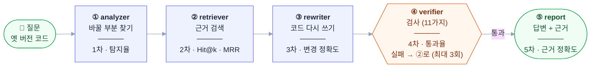

# LangChain 마이그레이션 도우미 — 역할 분담 계획서

**팀**: SKN35 3rd 4Team (4인)
**일정**: 2026-10-14(수) 기능 완성·통합 → 2026-10-15(목) 오전 최종 점검·리허설 → 2026-10-15(목) 오후 발표
**진행상황 기준 시각**: 2026-10-15 오전 11시 (dev 최신 `dcb96f7`, sungwook 최신 `a58c93b`, 각자 브랜치·디스코드 공유 내용 포함)
**배포 주소**: https://langchain-migration-assistant-btn5chcr8ragnwts68rmhf.streamlit.app/


## 목차

1. 계획서 메인
2. 날짜별 오전·오후 담당업무
3. 진행상황 (10/14 · 10/15)

---

## 1. 계획서 메인

### 1-1. 프로젝트 개요

옛 버전 LangChain 코드를 넣고 바꿀 버전을 말하면, **그 버전에서 돌아가는 코드로 고쳐 주고, 진짜 돌아가는지 확인까지 해 주는 챗봇**입니다. 고칠 때는 공식 문서와 import·메서드 대응표를 근거로 쓰고, 고친 뒤에는 검사합니다. 실패하면 실패 이유를 보고 근거를 다시 찾아 다시 고칩니다 (최대 3회).

| 항목 | 내용 |
|---|---|
| 주제(과제 요구) | LLM을 연동한 내외부 문서 기반 질의응답 시스템 |
| 목표 | LangChain 공식 문서·옛 마이그레이션 가이드·대응표를 청크·임베딩해 Chroma에 저장하고, LangGraph로 질문 분류 → (analyzer → retriever → rewriter → verifier)를 잇는 RAG 챗봇 |
| 배경 | 라이브러리는 빠르게 바뀌지만 인터넷의 글과 코드는 대부분 옛 버전입니다. 그래서 LLM은 복잡한 코드일수록 옛 방식을 답하고, 틀려도 모릅니다 ("버전 지체 환각") |
| 차별점 | **이중 검증**: ① 문서 근거 (바뀐 줄마다 근거 ID: 대응표 `imap-…`, 메서드 대응표 `mmap-…`, 문서 `doc-…`) ② 검사 근거 (verifier가 LLM 없이 11가지 검사, 실패하면 재시도) |
| 증명 방법 | 실무형 질문 30개를 일반 LLM과 우리 챗봇에 같은 모델로 넣고 같은 기준으로 성공률 비교 |
| 데모 포인트 | `LLMChain` → `prompt \| llm \| StrOutputParser()` 변환이 **1·2회차 실패 → 3회차 통과**하는 검증 루프 (10/14 실제 실행 2회 모두 3회차 통과), 바뀐 줄마다 근거, 진행 단계 실시간 표시, 대화 저장·다시 열기 |

### 1-2. 역할 분담

| 번호 | 담당 | 브랜치 | 맡은 영역 | 책임 산출물 |
|---|---|---|---|---|
| 1번 | 최우석 | wooos | 그래프·백엔드: 폴더 구조, 최상위 그래프(`supervisor.py`: 질문 분류 → migration · search · general), 변환 파이프라인(`migration.py`), 재시도 판단, analyzer · classifier 노드·프롬프트, dev 병합 관리 | `src/graph/supervisor.py`, `src/graph/migration.py`, `src/graph/nodes/analyzer_node.py`, `classifier_node.py`, `src/prompt/`, README 실행 방법 |
| 2번 | 손채영 | scy | 데이터·검색: 공식 문서·옛 가이드 수집, import·메서드 대응표, 청킹, 임베딩, Chroma Cloud, 하이브리드 검색, retriever · search 노드, 목표 버전 판정(`version_resolve`) | `src/rag/`, `data/`, `search_node.py`, 데이터 출처·전처리 문서 |
| 3번 | 조현주 | zozuzu | 변환·검증: State 설계, rewriter(근거 ID를 붙여 고쳐 쓰기), verifier(11가지 검사), rewriter 프롬프트 | `src/graph/state.py`, rewriter·verifier 노드, `src/prompt/rewriter_prompt.py` |
| 4번 | 심성욱 | sungwook | 화면·DB·평가: Streamlit 화면(대화형, 최상위 그래프 연결, 진행 표시, 결과 패널), TiDB 대화 기록, 실무형 질문 36개·비교 실험, 회의록, 보고서·README·발표 | `streamlit_app.py`·`src/ui/`(화면), `eval/`, `tools/`, `docs/`, 발표 PPT·대본 |

**report(⑤ 결과 정리)**: 별도 노드 없이, 화면이 State의 `changes`·`verify_result`·`attempt`·`unresolved`·`evidences`를 직접 읽어 결과 패널(전후 비교 · 변경 사항 · 근거 · 검사 결과 · 코드 받기)로 보여 주는 방식으로 확정 (10/15)

### 1-3. 시스템 구성

```text
Streamlit 화면 (streamlit_app.py: 대화 목록 · 진행 단계 표시 · 결과 패널)
   │  messages(자연어 + 코드) → supervisor().stream(...)
   ▼
최상위 그래프 (supervisor):  classifier ──┬── migration ─▶ 변환 파이프라인 (아래)
                                        ├── search    ─▶ 문서 검색으로 LangChain 질문 답변
                                        └── general   ─▶ 일반 답변
변환 파이프라인 (migration):  ① analyzer → ② retriever → ③ rewriter → ④ verifier ──통과──▶ 결과
                                           ▲                          │
                                           └──── 실패 이유·틀린 근거 ──┘ (exclude_ids, 최대 3회)
   ① analyzer: 코드와 목표 버전(target_version, 없으면 최신 1.4.5)을 질문에서 읽음
   ② retriever: 목표 버전 기준 대응표 정확 매칭 + Chroma·BM25 하이브리드 검색
   대화·사용자 기록: TiDB (users, chat_history)
```

## 1-4 RAG 테스트의 전체 구조


| 단계 | 하는 일 | 담당 |
|---|---|---|
| 0. 수집·전처리 (오프라인, 1회) | 최신 공식 문서·0.3.30 옛 가이드 수집, import·메서드 대응표 생성, 1.x 대표 버전 심볼(1.4.5) | 2번 |
| 0-1. 청킹 → 임베딩 → Chroma Cloud 적재 | 검색용 조각 만들기 | 2번 |
| 질문 분류 | migration · search · general로 나눔 | 1번 |
| ① analyzer | 질문에서 코드와 목표 버전을 뽑고 바꿔야 할 부분 찾기 (LLM) | 1번 |
| ② retriever | 목표 버전 기준 대응표에서 새 위치 찾기 + 문서 검색, 재시도 때 틀린 근거 제외 | 2번 |
| ③ rewriter | 근거를 보고 LLM이 코드 다시 쓰기, 바뀐 줄마다 근거 ID | 3번 |
| ④ verifier | LLM 없이 11가지 검사: 문법, 근거 ID, 변경 기록, 남은 옛 import, import 존재, 남은 옛 메서드, 안 쓰는 import, 반환값 보존, 정의 안 된 이름, 출력 꺼내기, 체인 입출력 키 | 3번 |
| 연결·재시도 판단 | 단계 연결, 다시 갈지 판단 | 1번 |
| 화면·대화 저장 | 결과 보여 주기(⑤ report 역할), 진행 단계 표시, 대화 기록 TiDB 저장 | 4번 |
| 평가 | 일반 LLM과 질문 30개 비교, 단계별 검증(1~5차) | 4번 (단계별 지표는 각 단계 담당과 함께) |

| 구성 요소 | 선택 |
|---|---|
| 언어·패키지 관리 | Python 3.12, uv (배포는 requirements.txt) |
| LLM 연동 | LangChain 1.x (기준 1.4.5), LangGraph, langchain-openai, Pydantic (구조화 출력) |
| LLM 모델 | gpt-4o-mini (일반 LLM 비교에도 같은 모델 사용) |
| 임베딩 / 벡터 DB | OpenAI text-embedding-3-small / Chroma Cloud (langchain-chroma) |
| 검색 | import·메서드 대응표 정확 매칭 + BM25·벡터 하이브리드 (RRF) |
| DB | TiDB Cloud (`users`, `chat_history`) |
| 화면 / 배포 | Streamlit / Streamlit Community Cloud ([배포 주소](https://langchain-migration-assistant-btn5chcr8ragnwts68rmhf.streamlit.app/)) |

### 1-4. 필수 산출물

| 산출물 | 담당 |
|---|---|
| 수집된 데이터 및 전처리 문서 | 2번 |
| 시스템 아키텍처 | 1번 (그래프), 2번 (데이터·검색) |
| RAG 기반 LLM과 벡터 DB 연동 코드 | 2번 (검색·벡터 DB), 3번 (변환·검증·프롬프트), 1번 (연결·analyzer·분류) |
| 테스트 계획 및 결과 보고서 | 4번 |
| 화면(데모) | 4번 |
| 발표 PPT | 각자 담당 영역 내용, 정리·발표 4번 |

**평가 목표**: 실무형 질문 30개 (10유형 × 3) + 버전 오가기 질문 6개를 일반 LLM과 우리 챗봇에 같은 모델로 넣어 비교

| 지표 | 뜻 | 목표 |
|---|---|---|
| 검증 통과율 | 고친 코드가 verifier 검사(import 존재 등)를 통과한 비율 | 일반 LLM 대비 [__]%p 이상 높게 |
| 근거 포함률 | 바뀐 줄에 근거 ID가 붙은 비율 | 100% (10/14 실행 사례 6/6) |
| 재시도 효과 | 1회차 통과율 → 최종(3회 이내) 통과율 | [__] |

### 1-5. 협업 규칙

- 브랜치: 담당자 브랜치 (wooos, scy, zozuzu, sungwook) → dev → main
- 자기 브랜치에서 작업한 뒤 dev로 PR, 다른 1명이 확인한 뒤 merge. main 직접 push 금지
- 작업 시작 전 dev를 받아와서 충돌을 작게 유지
- API 키·DB 비밀번호는 `.env`와 `.streamlit/secrets.toml`에만 둡니다 (깃에 올리지 않음)
- 다른 사람 영역의 파일을 고칠 때는 먼저 말하고 고칩니다 (`app.py`는 1번 그래프 실행 시험용, 화면 입구는 `streamlit_app.py`로 분리됨)
- 깃 관련 공유는 디스코드 깃 관리 채널에 남깁니다
- 매일 [13:40] 짧은 보고: 어제 한 일 / 오늘 할 일 / 필요한 것

---


## 2. 날짜별 오전·오후 담당업무

### 10/14(수) — 전체 그래프 연결, 화면 회의 결과 반영

| 담당 | 오전 | 오후 |
|---|---|---|
| 전원 | 최신 dev 받아서 작업 시작, 3번 State·노드 확인 | 담당 브랜치 dev 통합, 진행상황 공유 |
| 1번 | analyzer 프롬프트의 형식 충돌 확인 (다음 단계와 필드·키 맞추기) | supervisor에 retriever·rewriter·verifier 연결, 재시도 판단, `python app.py`로 전체 실행 |
| 2번 | `retriever_node.py` 작성 (근거를 `to_dict()` 형태로, `attempt`·`exclude_ids` 반영) | retriever dev 반영, 전체 실행에서 검색 결과 확인 |
| 3번 | zozuzu 브랜치 State·rewriter·verifier 리뷰 받기 | dev PR, 전체 실행에서 변환·검증 결과 확인 |
| 4번 | 회의 결과 반영: ChatGPT형 화면(대화 목록 사이드바), 변환할 버전 선택, 이어서 물어보기, TiDB 대화 저장 | TiDB·OpenAI 키 넣고 실제 저장 확인, 실무형 질문 30개 정리, 화면을 팀 저장소에 올릴 방법 1번과 협의 |

### 10/14(수) 밤 ~ 10/15(목) 새벽 — 최상위 그래프·목표 버전 (실제 진행)

| 담당 | 한 일 |
|---|---|
| 1번 | search 노드 적용 테스트, **최상위 그래프 `supervisor` 생성** (질문 분류 → migration · search · general), 변환 파이프라인을 `migration.py`로 분리, analyzer · classifier 프롬프트 수정 (PR #14, 02:50) |
| 2번 | **search 노드** (LangChain 질문을 문서 검색으로 답변), **목표 버전 판정** `version_resolve` + 1.x 대표 버전 심볼(1.4.5), State에 `target_version`, retriever 목표 버전 기준 검색, 다운그레이드 판정 수정 (PR #13, 01:48) |
| 3번 | dev 점검: classifier 출력(`general · langchain · migration`)과 graph 분기 키(`search`) 불일치 지적 → 1번이 분기 이름을 `general · search · migration`으로 통일해 해결 |
| 4번 | 발표 자료 초안(PPT·대본), 테스트 계획 및 결과 보고서 초안, README 초안 작성 |

### 10/15(목) 당일 — 최종 통합·점검·리허설·발표

| 시간 | 1번 | 2번 | 3번 | 4번 |
|---|---|---|---|---|
| ~10:30 (완료) | 남은 태스크 정리 (03:02) | README 수정 (PR #15, 10:39) | - | dev 반영, **화면을 최상위 그래프에 연결**, 결과 패널 개편, 배포 |
| 10:30 ~ 12:00 | 전체 그래프 실행 확인, search 프롬프트 보완 (벡터 DB에 마이그레이션 문서만 있어 LangChain 지식 질문 답변 품질 낮음) | 마이그레이션 방향 4가지 점검 (0.3 전 → 최신 · 옛 → 옛 · 버전 → 옛 · 1.x → 1.x), 검색 결과 확인 | 실제 실행 결과로 rewriter 프롬프트 · verifier 기준 점검 | 배포 화면에서 세 갈래(변환 · LangChain 질문 · 일반 질문) 시연 흐름 확인, TiDB 시험 계정 정리, 발표용 계정으로 데모 대화 미리 저장, PPT 화면 캡처 |
| 13:00 ~ 발표 전 | 1번 파트 발표 내용 확인 | 대본 토대로 데이터 파트 살 붙이기 | 변환·검증 파트 내용 확인 (3회차 통과 사례) | 리허설 진행 · 시간 측정, 비교 실험 결과 반영(나오면), PPT · 보고서 · README 최종본 |
| 발표 | 질문 대응 (그래프) | 질문 대응 (데이터·검색) | 질문 대응 (변환·검증) | 화면 시연, 발표 진행 |

### 정리한 남은 태스크 (10/15 03:02) — 담당·상태

| # | 태스크 | 담당 | 상태 |
|---|---|---|---|
| 1 | 화면에서 최상위 graph 흐름 테스트 및 데이터 확인 | 4번 (1번 확인) | ✅ 화면 → `supervisor()` 연결, 자동 점검 19/19 (10:26) · 🔄 배포 화면에서 세 갈래 시연 확인 |
| 2-1 | 현재 버전 · 목표 버전 지정 기능 제거 | 4번 | ✅ 버전 선택 상자 제거, 목표 버전은 그래프가 질문에서 읽음 |
| 2-2 | 이전 대화 내용 기록 저장되는지 확인 | 4번 | ✅ TiDB 저장 · 다시 열기 확인, 배포 화면 "대화 기록 저장: TiDB" |
| 2-3 | 자잘한 텍스트 수정 | 4번 | ✅ 버전 관련 안내 문구 정리 |
| 3 | 챗봇 답변 뒤 추천 질문 리스트 생성 | 4번 (1번과 협의) | 🔄 화면 저장소에 구현돼 있음(`followups`), 팀 브랜치 반영 여부 결정 필요 |
| 4 | 강사님 검증 파이프라인으로 각 단계별 검증 (1-4 구조: 탐지율 · Hit@k · MRR · 변경 정확도 · 통과율 · 근거 정확도) | 4번 + 각 단계 담당 | ⬜ |
| 5 | 예제 30개 | 4번 | ✅ `eval/questions.json` 36개 (1.x로 올리기 30 + 버전 오가기 6), 화면 사이드바 확인용 예제 30개 |

## 3. 진행상황

✅ 완료 · 🔗 연계 (앞 시간에 시작해 이어서 한 작업) · 🔄 진행 중 · ⬜ 예정

### 3-1. 담당자별 — 10/14(수)

| 담당 | 오전 | 오후 |
|---|---|---|
| 1번 | ✅ **폴더 구조**: `app.py`, `src/graph`(그래프·노드), `src/rag`(검색), `src/prompt`, `data/`로 나눔<br>✅ **uv 프로젝트 설정**: Python 3.12, LangChain 1.x·LangGraph·langchain-openai·langchain-chroma·Pydantic<br>✅ **그래프 틀**: `StateGraph`로 시작 → 노드 → 끝 구조 (`supervisor.py`)<br>✅ **analyzer 노드·프롬프트** (PR #5): 질문에서 코드를 뽑고 바꿔야 할 부분을 목록으로 정리 (LLM)<br>🔗 **analyzer 출력 형식 맞추기** 시작: 3번 State와 필드·키가 다른 부분 확인 → 오후로 이어짐 | ✅🔗 **analyzer 출력 형식 맞추기** 완료: analyzer 프롬프트를 다음 단계(retriever·rewriter)가 읽는 필드에 맞게 수정 (PR #7)<br>✅ **전체 노드 연결**: analyzer → retriever → rewriter → verifier를 한 그래프로 연결 (`supervisor.py`)<br>✅ **재시도 판단**: verifier 실패 시 retriever로 돌아가고, 한도에 닿으면 종료<br>🔗 **그래프 고도화** (PR #11): 질문 분류 노드 추가 → 코드 변환 질문은 마이그레이션 흐름으로, 일반 질문은 일반 답변·검색 노드로 나눔 (`classifier`·`general`·`search` 노드) → 밤에 이어짐 |
| 2번 | ✅ **import 대응표** (9,155줄): 옛 버전·1.x 패키지 코드를 비교해 옛 위치 → 새 위치, `@deprecated` 정보·대안까지 기록, langchain-cli 변환 규칙으로 보강<br>✅ **메서드 대응표** (42개): `.run()` → `.invoke()` 같은 호출 방식 변경<br>✅ **최신 공식 문서 수집** (271개): docs.langchain.com Python 문서, v1 마이그레이션 가이드 포함<br>✅ **옛 가이드 수집** (24개): 0.3.30 태그의 체인·메모리·에이전트 옮기는 법<br>✅ **청킹** (11,945개) → **Chroma 적재** (text-embedding-3-small)<br>✅ **하이브리드 검색** (PR #4): 대응표 정확 매칭 + BM25·벡터 검색 순위 합치기 (RRF)<br>🔗 **retriever 노드** 작성 시작 → 오후로 이어짐 | ✅🔗 **retriever 노드** 완료: 대응표 정확 매칭 + 문서 검색 결과를 근거 목록(`evidences`)으로 State에 넘김 (PR #6)<br>✅ **analyzer 결과 연결**: analyzer가 찾은 문제 목록으로 검색하고, 대응표에 없으면 문서 보조 검색 (PR #9)<br>✅ **벡터 DB를 Chroma Cloud로 이전**: 저장소에 올라가 있던 약 133MB 로컬 DB 파일을 지우고 클라우드에서 검색 → 팀원 누구나 같은 DB 사용 (PR #10, `.env`에 접속 정보 추가)<br>🔗 **search 노드** 시작 (21:11) → 밤에 이어짐 |🔗 **보고서·발표**: PPT · 대본 · 보고서 · README 초안 → 10/15로 이어짐 |
| 3번 | ✅ **State 확장**: 입력 코드·분석 결과·새 코드·변경 목록(바뀐 줄마다 근거 ID)·검증 결과·재시도 횟수·제외할 근거·바꾸지 못한 코드·설치할 패키지 칸 추가 (dev 반영)<br>✅ **폴더 정리**: 빈 `src/agents` 삭제, 노드는 `src/graph/nodes/`로 통일<br>✅ **rewriter 노드·프롬프트**: 근거를 보고 LLM이 코드를 다시 쓰고, 바뀐 줄마다 근거 ID(`imap-`·`mmap-`·`doc-`)를 붙임<br>✅ **verifier 노드**: 문법, 근거 ID, 변경 기록, 남은 옛 import, import 존재, 남은 옛 메서드, 안 쓰는 import, 반환값 보존<br>✅ **샘플 코드 3회차 통과 확인**: 1·2회차 실패 → 실패 이유를 다음 시도에 넘겨 3회차 통과<br>🔗 **리뷰 요청** (zozuzu 브랜치) → 오후에 dev 반영 | ✅🔗 **rewriter·verifier dev 반영**: 리뷰 반영해 rewriter·프롬프트 보완, verifier 검사 로직 대폭 보강 (약 400줄, **검사 11가지**로 확장: 정의 안 된 이름 · 출력 꺼내기 · 체인 입출력 키 추가)<br>✅ **노드 점검 스크립트** (`check_nodes.py`): 노드를 하나씩 실행해 입력·출력을 확인<br>✅ **실행 시험용 `app.py` 갱신**: 전체 그래프를 한 번에 돌려 보는 코드<br>🔗 전체 실행 결과로 프롬프트·검사 기준 다듬기 → 10/15로 이어짐 |
| 4번 | ✅ **주간회의 회의록** (10/13): 역할별 이번 주 할 일, 공유된 데이터 출처, 다음 회의까지 확인할 것<br>✅ **화면 초안** (sungwook 브랜치): 버전 마인드맵 → 채팅 → 결과 패널(바뀐 줄 비교·근거·검증 배지), 가짜 결과로 동작<br>✅ **화면 배포**: Streamlit Cloud에 올려 누구나 주소로 확인 가능<br>🔗 **회의 결과 반영** 시작: 10/14 아침 회의에서 정한 대화형 화면·TiDB 저장·버전 선택·이어서 물어보기 → 오후로 이어짐<br>🔗 **실무형 질문** 작성 시작 → 오후로 이어짐 | ✅🔗 **회의 결과 반영** 완료: ChatGPT형 화면 (사이드바 = 새 대화·내 대화 목록·로그아웃), 세션별 대화 저장<br>✅ **TiDB 연동**: 팀 ERD(`users`, `chat_history`)로 대화 기록 저장, 가입할 때 아이디 중복 검사, 내 대화만 보이게 분리<br>✅ **TiDB 실제 접속 확인** + 접속 정보가 없거나 틀리면 로컬 저장으로 넘어가고 이유 표시 (발표 중 DB 장애 대비)<br>✅🔗 **실무형 질문 36개** 완료: 1.x로 올리기 30개 (10유형 × 3) + 버전 오가기 6개, 36/36 검사 통과, 화면 사이드바 확인용 예제 30개<br>✅ **`app.py` 충돌 해소**: 화면 입구를 `streamlit_app.py`로 분리하고 `app.py`는 dev(그래프 실행용) 그대로 유지, dev 최신 반영<br>✅ **그래프 연결**: 가짜 결과 → 실제 그래프 결과(State)로 교체, LLMChain 예제 2회 실행 모두 3회차 통과 · 바뀐 6줄 모두 근거 ID 확인<br>✅ **배포 저장소** (`langchain-migration-assistant`) 생성, Streamlit Cloud Secrets 연결 문제 해결<br>

### 3-1. 담당자별 — 10/15(목)

| 담당 | 밤 ~ 새벽 (10/14 21시 ~ 10/15 03시) | 오전 (~11시) | 오후 (예정) |
|---|---|---|---|
| 1번 | ✅ **search 노드 적용 테스트** (00:21)<br>✅ **최상위 그래프 `supervisor()`**: 질문 분류 → migration · search · general (PR #14, 02:50)<br>✅ **변환 파이프라인 분리**: 기존 그래프를 `migration.py`로, 입력을 `messages` 형식으로<br>✅ **analyzer · classifier 프롬프트 수정**: 분기 이름 `general · search · migration`으로 통일 (3번 지적 반영)<br>✅ **남은 태스크 정리** (03:02, 위 표) | 🔄 전체 그래프 실행 확인<br>🔄 search 프롬프트 보완 (LangChain 지식 질문은 벡터 DB에 마이그레이션 문서만 있어 답변 품질 낮음) | ⬜ 4번과 화면 연결 확인 (배포 화면)<br>⬜ 그래프 파트 발표 내용 확인, 질문 대응 |
| 2번 | ✅ **search 노드** (21:11): LangChain 질문을 문서 검색으로 답변<br>✅ **1.x 대표 버전 심볼 + 최신 1.4.5 반영** (00:51)<br>✅ **목표 버전 판정** `version_resolve` (01:01): 목표 버전 기준으로 import 경로 판정<br>✅ **State `target_version`** (01:06) + **retriever 목표 버전 기준 검색** (01:13)<br>✅ **다운그레이드 파트너 패키지 판정 수정 · analyzer 목표 버전 연결** (PR #13, 01:48)<br>✅ **마이그레이션 방향 4가지 정리**: 0.3 전 → 최신 · 옛 → 옛 · 버전 → 옛 · 1.x → 1.x | ✅ **README 수정** (PR #15, 10:39) | ⬜ 대본 토대로 데이터 파트 발표 내용 살 붙이기<br>⬜ 데이터 출처 · 전처리 문서 정리<br>⬜ 질문 대응 (데이터 · 검색) |
| 3번 | ✅ **dev 점검**: classifier 출력과 graph 분기 키 불일치 지적 → 해결<br>✅ **발표 자료 피드백**: 수치와 tester(시험 방법)가 명확하게 들어간 자료가 좋다 | 🔄 실제 실행 결과로 rewriter 프롬프트 · verifier 검사 기준 점검 | ⬜ 변환 · 검증 파트 발표 내용 확인 (3회차 통과 사례)<br>⬜ 4번과 평가 채점 기준 맞추기<br>⬜ 질문 대응 (변환 · 검증) |
| 4번 | ✅ **발표 자료 초안**: PPT (애플 플랫, 본편 14 + 부록 3), 발표 대본 PDF (장마다 훅 → 설명 → 넘기는 말, 약 13분)<br>✅ **테스트 계획 및 결과 보고서** 초안 (PDF 13쪽)<br>✅ **README**: 배포 저장소 완성본 + 팀 초안 (`docs/README_초안.md`) | ✅ **dev 최신 반영** (09:22)<br>✅ **화면을 최상위 그래프에 연결** (10:26): 코드 변환 · LangChain 질문 · 일반 질문 모두 그래프가 답함<br>✅ **버전 선택 상자 제거**: 바꿀 버전은 질문에서 그래프가 읽음, 배지는 "원래 버전 → 바꾼 버전"<br>✅ **진행 단계 실시간 표시** (graph.stream), 검사 실패 시 **다시 시도** 버튼<br>✅ **결과 패널 개편**: 전후 비교(빨강 · 초록) · 변경 사항 · 근거 · 검사 결과(11가지) · 코드 받기(.py · .md)<br>✅ **자동 점검 19/19**, 1.x 기준 1.4.5 반영<br>✅ **배포 반영 · 확인**: Streamlit Cloud ImportError(옛 모듈 캐시) → Reboot로 해결, "대화 기록 저장: TiDB" 확인<br>✅ **README · PLAN 갱신** | 🔄 배포 화면에서 세 갈래 시연 흐름 확인<br>⬜ TiDB 시험 계정 정리, 발표용 계정으로 데모 대화 미리 저장 (변환 1분 대비)<br>⬜ PPT 9장 화면 캡처, 배포 주소 반영<br>⬜ 비교 실험 (결과 나오면 PPT 12장 · 보고서 · README 숫자 채우기)<br>⬜ 리허설 · 시간 측정, 발표 진행 · 화면 시연 |


### 3-2. 기능별

| 기능 | 상태 | 비고 |
|---|---|---|
| 데이터 수집·대응표 | ✅ | 출처 4가지: PyPI 패키지 코드, langchain-cli 변환 규칙, 최신 공식 문서, 0.3.30 옛 가이드 · 1.x 대표 버전 1.4.5 |
| 벡터 DB·검색 | ✅ | Chroma Cloud, 대응표 정확 매칭 + 하이브리드 검색, 목표 버전 기준 검색 |
| 질문 분류 · 최상위 그래프 | ✅ | `supervisor()`: migration · search · general (10/15 새벽) |
| ① analyzer | ✅ | 목표 버전(`target_version`) 읽기 추가 |
| ② retriever 노드 | ✅ | 목표 버전 기준 검색 |
| ③ rewriter | ✅ | dev 반영 |
| ④ verifier | ✅ | 11가지 검사, dev 반영 |
| 재시도 루프 | ✅ | 실패 → retriever, 최대 3회 (실행 사례 3회차 통과) |
| search · general 답변 | ✅ | 🔄 search 프롬프트 보완 중 (1번) |
| 전체 그래프 실행 | ✅ | 화면 → `supervisor()` 연결, 진행 단계 실시간 표시 |
| 화면 | ✅ | 버전 선택 제거, 결과 패널 5탭, 다시 시도, 확인용 예제 30개, 배포 완료 |
| 대화 기록 저장 (TiDB) | ✅ | 배포 화면에서 TiDB 연결 확인 |
| 추천 질문 리스트 | 🔄 | 화면 저장소에 구현, 팀 브랜치 반영 여부 결정 필요 |
| 단계별 검증 (1~5차) | ⬜ | 강사님 검증 파이프라인 기준 |
| 비교 실험 | ⬜ | 일반 LLM vs 우리 챗봇, 질문 30개 |

### 3-3. 필수 산출물

| 산출물 | 상태 |
|---|---|
| 수집된 데이터 및 전처리 문서 | 🔄 데이터 완료, README 수정(10/15) · 문서 정리 [__] |
| 시스템 아키텍처 | 🔄 최상위 그래프 확정(10/15), 문서 [__] |
| RAG 기반 LLM과 벡터 DB 연동 코드 | ✅ dev 반영 (분류 · 변환 · 검색 · 검증 · 화면 연결) |
| 테스트 계획 및 결과 보고서 | 🔄 계획 · 화면/DB 점검 · 실행 사례 작성 완료, 비교 실험 결과 [__] |
| 발표 PPT | 🔄 본편 14장 + 부록 3장 · 대본 완료, 화면 캡처 · 결과 숫자 [__] |

### 3-4. 리스크

| 리스크 | 대응 | 담당 | 상태 |
|---|---|---|---|
| 노드끼리 주고받는 형식이 달라 전체 실행이 안 됨 | 최상위 그래프 · State 통일, 화면에서 전체 실행 | 1번, 2번, 3번 | ✅ 해결 |
| dev의 `app.py`를 1번(그래프 시험용)과 4번(화면)이 같이 씀 | 화면 입구를 `streamlit_app.py`로 분리 | 1번, 4번 | ✅ 해결 |
| 화면은 모든 버전 방향을 고를 수 있지만 rewriter는 1.x로 바꾸기만 만듦 | 목표 버전을 질문에서 읽어 그래프 전체에 넘김(`target_version`), 화면 버전 선택 제거 | 전원 | ✅ 해결 (되돌리기 통과율은 아직 낮음) |
| 분기 키가 파일마다 다름 (classifier vs graph) | `general · search · migration`으로 통일 | 1번, 3번 | ✅ 해결 |
| 재시도해도 같은 오답 반복 | verifier가 틀린 근거를 `exclude_ids`로 넘겨 다음 검색에서 제외 | 2번, 3번 | 🔄 |
| LangChain 지식 질문(search) 답변 품질 낮음 | 벡터 DB가 마이그레이션 문서 위주 → 프롬프트 보완 | 1번, 2번 | 🔄 |
| 검증 기준이 평가 기준과 달라 비교가 불공정 | 평가 채점에 verifier와 같은 검사 기준 사용 | 3번, 4번 | 🔄 |
| 일반 LLM과 비교 조건이 다름 | 같은 모델·같은 질문·같은 채점 기준으로 고정 | 4번 | 🔄 |
| TiDB 접속 오류 | 접속 실패 시 로컬 저장으로 넘어감, 배포 화면에서 저장 · 다시 열기 확인 | 4번 | ✅ 대비 완료 |
| 배포 화면 오류 (옛 모듈 캐시 등) | 코드 반영 후 Reboot app, 로그 확인 | 4번 | ✅ 10/15 해결 |
| 벡터 DB 파일이 커서(약 133MB) 공유·실행이 어려움 | Chroma Cloud로 이전 | 2번 | ✅ 해결 |
| 발표 중 API 오류 · 느린 응답 (변환 약 1분) | 발표용 계정에 데모 대화 미리 저장 + 진행 단계 표시 + 데모 녹화 | 4번 | 🔄 |
| 발표 시간 초과 | 대본 본편 약 13분, 리허설에서 측정 | 4번 | ⬜ |
