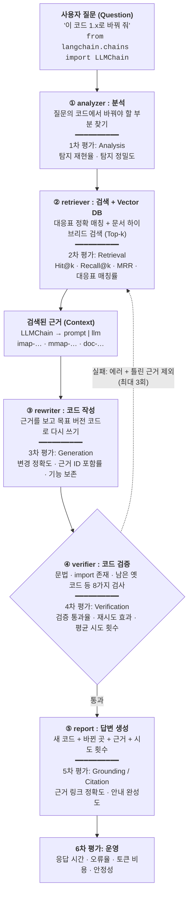

# LangChain 마이그레이션 도우미 — 역할 분담 계획서

**팀**: SKN35 3rd 4Team (4인)
**일정**: 2026-10-14(수) ~ 2026-10-14(수) 기능 완성·통합 → 2026-10-15(목) 오전 최종 점검·리허설 → 2026-10-15(목) 
**진행상황 기준 시각**: 2026-10-14 오전 (dev 최신 `62da4ff`, 각자 브랜치·디스코드 공유 내용 포함)


## 목차

1. 계획서 메인
2. 날짜별 오전·오후 담당업무
3. 진행상황

---

## 1. 계획서 메인

### 1-1. 프로젝트 개요

옛 버전 LangChain 코드를 넣고 변환할 버전을 고르면, **그 버전에서 돌아가는 코드로 고쳐 주고, 진짜 돌아가는지 확인까지 해 주는 챗봇**입니다. 고칠 때는 공식 문서와 import·메서드 대응표를 근거로 쓰고, 고친 뒤에는 검사합니다. 실패하면 실패 이유를 보고 근거를 다시 찾아 다시 고칩니다 (최대 3회).

| 항목 | 내용 |
|---|---|
| 주제(과제 요구) | LLM을 연동한 내외부 문서 기반 질의응답 시스템 |
| 목표 | LangChain 공식 문서·옛 마이그레이션 가이드·대응표를 청크·임베딩해 Chroma에 저장하고, LangGraph로 analyzer → retriever → rewriter → verifier를 잇는 RAG 챗봇 |
| 배경 | 라이브러리는 빠르게 바뀌지만 인터넷의 글과 코드는 대부분 옛 버전입니다. 그래서 LLM은 복잡한 코드일수록 옛 방식을 답하고, 틀려도 모릅니다 ("버전 지체 환각") |
| 차별점 | **이중 검증**: ① 문서 근거 (바뀐 줄마다 근거 ID: 대응표 `imap-…`, 메서드 대응표 `mmap-…`, 문서 `doc-…`) ② 실행 근거 (verifier가 문법·import 존재·남은 옛 import 등을 검사, 실패하면 재시도) |
| 증명 방법 | 실무형 질문 30개를 일반 LLM과 우리 챗봇에 같은 모델로 넣고 같은 기준으로 성공률 비교 |
| 데모 포인트 | `LLMChain` → `prompt \| llm \| StrOutputParser()` 변환이 **1·2회차 실패 → 3회차 통과**하는 검증 루프, 바뀐 줄마다 근거, 대화 저장·다시 열기, 이어서 물어보기 |

### 1-2. 역할 분담

| 번호 | 담당 | 브랜치 | 맡은 영역 | 책임 산출물 |
|---|---|---|---|---|
| 1번 | 최우석 | 그래프·백엔드: 폴더 구조, LangGraph 노드 연결(`supervisor.py`), 재시도 판단, analyzer 노드·프롬프트, dev 병합 관리 | `src/graph/supervisor.py`, `src/graph/nodes/analyzer_node.py`, `src/prompt/analyzer_prompt.py`, README 실행 방법 |
| 2번 | 손채영 | 데이터·검색: 공식 문서·옛 가이드 수집, import·메서드 대응표, 청킹, 임베딩, Chroma 적재, 하이브리드 검색, retriever 노드 | `src/rag/`, `data/`, 데이터 출처·전처리 문서 |
| 3번 | 조현주 | 변환·검증: State 설계, rewriter(근거 ID를 붙여 고쳐 쓰기), verifier(8가지 검사), rewriter 프롬프트 | `src/graph/state.py`, rewriter·verifier 노드, `src/prompt/` |
| 4번 | 심성욱 | 화면·평가: Streamlit 화면(대화형, TiDB 저장, 버전 선택, 이어서 물어보기), 실무형 질문 30개·비교 실험·그래프, 회의록, 보고서·README·발표 | `app.py`(화면), `eval/`, `docs/`, 발표 PPT |

**report(⑤ 결과 정리)**:  State의 `changes`·`verify_result`·`attempt`·`unresolved` 등을 화면이 직접 읽어서 보여 주는 방식으로 진행 중. 별도 report 노드가 필요 여부 확인

### 1-3. 시스템 구성

```text
Streamlit 화면 (대화 목록·변환할 버전 선택·결과 패널)
   │  question(자연어 + 코드) → migration_pipeline().invoke(...)
   ▼
LangGraph:  ① analyzer → ② retriever → ③ rewriter → ④ verifier ──통과──▶ 결과
                              ▲                          │
                              └──── 실패 이유·틀린 근거 ──┘ (exclude_ids, 최대 3회)
   ② retriever: import·메서드 대응표 정확 매칭 + Chroma·BM25 하이브리드 검색
   대화·사용자 기록: TiDB
```

## 1-4 RAG 테스트의 전체 구조


| 단계 | 하는 일 | 담당 |
|---|---|---|
| 0. 수집·전처리 (오프라인, 1회) | 최신 공식 문서·0.3.30 옛 가이드 수집, import·메서드 대응표 생성 | 2번 |
| 0-1. 청킹 → 임베딩 → Chroma 적재 | 검색용 조각 만들기 | 2번 |
| ① analyzer | 질문에서 코드를 뽑고 바꿔야 할 부분 찾기 (LLM) | 1번 |
| ② retriever | 대응표에서 새 위치 찾기 + 문서 검색, 재시도 때 틀린 근거 제외 | 2번 |
| ③ rewriter | 근거를 보고 LLM이 코드 다시 쓰기, 바뀐 줄마다 근거 ID | 3번 |
| ④ verifier | LLM 없이 8가지 검사: 문법, 근거 ID, 변경 기록, 남은 옛 import, import 존재, 남은 옛 메서드, 안 쓰는 import, 반환값 보존 | 3번 |
| 연결·재시도 판단 | 단계 연결, 다시 갈지 판단 | 1번 |
| 화면·대화 저장 | 결과 보여 주기, 대화 기록 TiDB 저장, 이어서 물어보기 | 4번 |
| 평가 | 일반 LLM과 질문 30개 비교 | 4번 |

| 구성 요소 | 선택 |
|---|---|
| 언어·패키지 관리 | Python 3.12, uv |
| LLM 연동 | LangChain 1.x, LangGraph, langchain-openai, Pydantic (구조화 출력) |
| LLM 모델 | [모델명] (일반 LLM 비교에도 같은 모델 사용) |
| 임베딩 / 벡터 DB | OpenAI text-embedding-3-small / Chroma (langchain-chroma) |
| 검색 | import·메서드 대응표 정확 매칭 + BM25·벡터 하이브리드 (RRF) |
| DB | TiDB Cloud (사용자, 대화, 메시지 기록) |
| 화면 / 배포 | Streamlit / Streamlit Cloud ([배포 주소]) |

### 1-4. 필수 산출물

| 산출물 | 담당 |
|---|---|
| 수집된 데이터 및 전처리 문서 | 2번 |
| 시스템 아키텍처 | 1번 (그래프), 2번 (데이터·검색) |
| RAG 기반 LLM과 벡터 DB 연동 코드 | 2번 (검색·벡터 DB), 3번 (변환·검증·프롬프트), 1번 (연결·analyzer) |
| 테스트 계획 및 결과 보고서 | 4번 |
| 화면(데모) | 4번 |
| 발표 PPT | 각자 담당 영역 슬라이드, 정리·발표 4번 |

**평가 목표**: 실무형 질문 30개 (10유형 × 3) + 버전 오가기 질문 [6]개를 일반 LLM과 우리 챗봇에 같은 모델로 넣어 비교

| 지표 | 뜻 | 목표 |
|---|---|---|
| 검증 통과율 | 고친 코드가 verifier 검사(import 존재 등)를 통과한 비율 | 일반 LLM 대비 [__]%p 이상 높게 |
| 근거 포함률 | 바뀐 줄에 근거 ID가 붙은 비율 | [100]% |
| 재시도 효과 | 1회차 통과율 → 최종(3회 이내) 통과율 | [__] |

### 1-5. 협업 규칙

- 브랜치: 담당자 브랜치 (wooos, scy, zozuzu, sungwook) → dev → main
- 자기 브랜치에서 작업한 뒤 dev로 PR, 다른 1명이 확인한 뒤 merge. main 직접 push 금지
- 작업 시작 전 dev를 받아와서 충돌을 작게 유지
- API 키·DB 비밀번호는 `.env`와 `.streamlit/secrets.toml`에만 둡니다 (깃에 올리지 않음)
- 다른 사람 영역의 파일을 고칠 때는 먼저 말하고 고칩니다 (예: dev의 `app.py`는 1번이 그래프 실행 시험용으로 사용 중)
- 깃 관련 공유는 디스코드 깃 관리 채널에 남깁니다
- 매일 [13:40] 짧은 보고: 어제 한 일 / 오늘 할 일 / 필요한 것

---


## 2. 날짜별 오전·오후 담당업무

### 10/14(수) — 전체 그래프 연결, 화면 회의 결과 반영

| 담당 | 오전 | 오후 |
|---|---|---|
| 전원 | 최신 dev 받아서 작업 시작, 3번 State·노드 확인 | 담당 브랜치 dev 통합, 진행상황 공유 |
| 1번 | analyzer 프롬프트의 형식 충돌 확인 (다음 단계와 필드·키 맞추기) | supervisor에 retriever·rewriter·verifier 연결, 재시도 판단, `python app.py`로 전체 실행 |
| 2번 | `retriever_node.py` 작성 (근거를 `to_dict()` 형태로, `attempt`·`exclude_ids` 반영) | retriever dev 반영, 전체 실행에서 검색 결과 확인 |
| 3번 | zozuzu 브랜치 State·rewriter·verifier 리뷰 받기 | dev PR, 전체 실행에서 변환·검증 결과 확인 |
| 4번 | 회의 결과 반영: ChatGPT형 화면(대화 목록 사이드바), 변환할 버전 선택, 이어서 물어보기, TiDB 대화 저장 | TiDB·OpenAI 키 넣고 실제 저장 확인, 실무형 질문 30개 정리, 화면을 팀 저장소에 올릴 방법 1번과 협의 |

### 10/15(목) — 화면·그래프 연결, 품질 개선

| 담당 | 오전 | 오후 |
|---|---|---|
| 전원 | 최신 dev 받아서 전체 그래프 실행 확인, 남은 오류 담당자에게 공유 | 담당 브랜치 dev 통합, 진행상황 공유 |
| 1번 | 전체 그래프 오류 수정, 재시도 한도(3회)에서 종료 확인, 화면이 부를 입구 함수 정리 | 실행 로그 남기기 (시도마다 실패 이유 기록), 4번과 화면 연결 확인 |
| 2번 | 재시도 때 틀린 근거 제외(`exclude_ids`) 동작 확인, 검색 결과 점검 | 검색 튜닝 (top-k, 근거 순위), 데이터 출처·전처리 문서 작성 |
| 3번 | 전체 실행 결과로 rewriter 프롬프트 보완 (근거 ID 누락, 변경 기록 누락) | verifier 검사 기준 점검, 4번과 평가 채점 기준 맞추기 |
| 4번 | 화면을 진짜 그래프에 연결 (가짜 결과 → 실제 State) | 실무형 질문 30개 확정, 일반 LLM 실험 (비교 기준선), 3번과 채점 기준 맞추기 |

### 10/15(목) — 비교 실험, 문서·발표 자료

| 담당 | 오전 | 오후 |
|---|---|---|
| 전원 | 질문 30개로 나온 오답을 각자 영역에서 원인 확인 | 담당 파트 발표 슬라이드 내용 전달 (그림·핵심 문장) |
| 1번 | 오답 중 그래프·재시도 문제 수정, 최종 dev 정리 | 시스템 아키텍처 문서 (그래프 흐름도), README 실행 방법 |
| 2번 | 오답 중 검색 문제 수정 (근거가 없거나 틀린 경우) | 데이터 파트 슬라이드 (출처 4가지, 대응표·청크 수) |
| 3번 | 오답 중 변환·검증 문제 수정 | 변환·검증 파트 슬라이드 (검증 루프 3회차 통과 사례) |
| 4번 | 우리 챗봇 비교 실험 (질문 30개 × 같은 모델) | 결과 그래프, 테스트 결과 보고서, 발표 자료 초안, 데모 녹화 |

### 10/15(목) 오전 — 최종 점검·리허설

| 담당 | [09:00 ~ 10:30] 최종 점검 | [10:30 ~ 12:00] 리허설 |
|---|---|---|
| 전원 | 배포 주소에서 시연 흐름 1회 실행 | [__]분 리허설, 시간 측정 |
| 1번 | 그래프 전체 실행·재시도 확인 | 그래프·백엔드 파트 설명 |
| 2번 | 검색 결과·근거 확인 | 데이터·검색 파트 설명 |
| 3번 | 시연 코드 변환·검증 결과 확인 | 변환·검증 파트 설명 |
| 4번 | 화면·TiDB 최종 확인, 평가 결과·그래프·발표 자료 최종본 | 화면 시연, 평가 결과 설명, 발표 진행 |

10/15(목) 오후발표.

## 3. 진행상황

10/14 오전 기준입니다. ✅ 완료 · 🔄 진행 중 · ⬜ 예정

### 3-1. 담당자별

| 담당 | 진행상황 |
|---|---|
| 1번 | ✅ 폴더 구조 ✅ uv 프로젝트 설정 ✅ 그래프 틀 ✅ analyzer 노드·프롬프트 (PR #5) 🔄 analyzer 출력 형식 맞추기 ⬜ 전체 노드 연결 ⬜ 재시도 판단 |
| 2번 | ✅ import 대응표 (9,155줄) ✅ 메서드 대응표 ✅ 최신 공식 문서 수집 (271개) ✅ 옛 가이드 수집 (24개) ✅ 청킹 (11,903개) ✅ Chroma 적재 ✅ 하이브리드 검색 (PR #4) 🔄 retriever 노드 |
| 3번 | ✅ State 확장 (변경 목록·검증 결과·재시도 횟수·제외 근거 등) ✅ rewriter 노드·프롬프트 ✅ verifier 노드 (8가지 검사) ✅ 샘플 코드 3회차 통과 확인 (zozuzu 브랜치) 🔄 리뷰 후 dev PR |
| 4번 | ✅ 주간회의 회의록 ✅ 화면 초안 (sungwook 브랜치) ✅ 화면 배포 (Streamlit Cloud) 🔄 회의 결과 반영 (대화형 화면·TiDB·버전 선택·이어서 물어보기) 🔄 실무형 질문 30개 ⬜ TiDB 실제 접속 확인 ⬜ 그래프 연결 ⬜ 비교 실험 ⬜ 보고서·발표 |

### 3-2. 기능별

| 기능 | 상태 | 비고 |
|---|---|---|
| 데이터 수집·대응표 | ✅ | 출처 4가지: PyPI 패키지 코드, langchain-cli 변환 규칙, 최신 공식 문서, 0.3.30 옛 가이드 |
| 벡터 DB·검색 | ✅ | 대응표 정확 매칭 + 하이브리드 검색 |
| ① analyzer | ✅ | dev 반영 |
| ② retriever 노드 | 🔄 | 2번 작성 중 |
| ③ rewriter | ✅ | zozuzu 브랜치, dev 반영 전 |
| ④ verifier | ✅ | zozuzu 브랜치, dev 반영 전 |
| 재시도 루프 | 🔄 | 3번 노드에는 있음, 그래프 연결은 1번 |
| 전체 그래프 실행 | ⬜ | 오늘 목표 |
| 화면 | 🔄 | 대화 목록·버전 선택·결과 패널·이어서 물어보기, 지금은 가짜 결과 |
| 대화 기록 저장 (TiDB) | 🔄 | 테이블 설계 완료, 실제 접속 확인 전 |
| 비교 실험 | ⬜ | 전체 그래프 완성 후 |

### 3-3. 필수 산출물

| 산출물 | 상태 |
|---|---|
| 수집된 데이터 및 전처리 문서 | 🔄 데이터 완료, 문서 정리 [__] |
| 시스템 아키텍처 | 🔄 설계 합의, 문서 [__] |
| RAG 기반 LLM과 벡터 DB 연동 코드 | 🔄 검색·analyzer dev 반영, 변환·검증은 브랜치에 완성, 연결 진행 중 |
| 테스트 계획 및 결과 보고서 | 🔄 질문 30개 정리 중, 결과 미작성 |
| 발표 PPT | ⬜ |

### 3-4. 리스크

| 리스크 | 대응 | 담당 |
|---|---|---|
| 노드끼리 주고받는 형식이 달라 전체 실행이 안 됨 | analyzer 출력 형식을 3번 State에 맞추고, 오늘 `python app.py`로 전체 실행 | 1번, 2번, 3번 |
| dev의 `app.py`를 1번(그래프 시험용)과 4번(화면)이 같이 씀 | 화면을 올리기 전에 1번과 파일 위치 협의 | 1번, 4번 |
| 화면은 모든 버전 방향을 고를 수 있지만 rewriter는 1.x로 바꾸기만 만듦 | 목표 버전을 파이프라인에 넘길지, 화면을 1.x만으로 줄일지 회의에서 결정 | 전원 |
| 재시도해도 같은 오답 반복 | verifier가 틀린 근거를 `exclude_ids`로 넘겨 다음 검색에서 제외 | 2번, 3번 |
| 검증 기준이 평가 기준과 달라 비교가 불공정 | 평가 채점에 verifier와 같은 검사 기준 사용 | 3번, 4번 |
| 일반 LLM과 비교 조건이 다름 | 같은 모델·같은 질문·같은 채점 기준으로 고정 | 4번 |
| TiDB 접속 오류 | 발표 전 배포 화면에서 저장·다시 열기 확인, 안 되면 저장 없이 시연 | 4번 |
| 벡터 DB 파일이 커서(약 133MB) 공유·실행이 어려움 | [깃 제외 + 재생성 스크립트 / 공유 드라이브] | 2번 |
| 발표 중 API 오류·느린 응답 | 시연 결과를 미리 저장해 둔 대화 + 데모 녹화 | 4번 |
| 발표 시간 초과 | 리허설에서 [__]분 측정 | 4번 |
