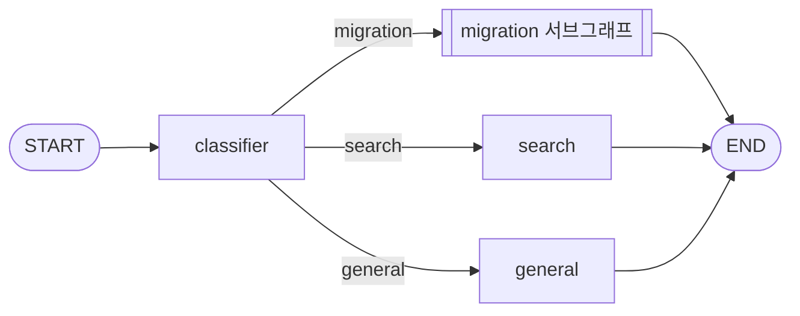
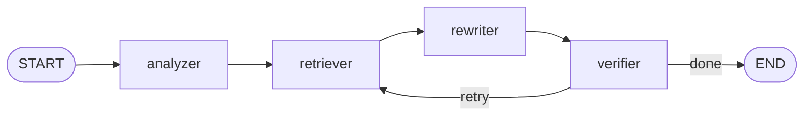

# SKN35-3rd-4Team — LangChain 마이그레이션 RAG 챗봇

구버전 LangChain 코드를 넣으면 **공식 문서와 import 대응표를 근거로** LangChain 1.x(또는 질문에서 지정한 버전) 코드로 바꿔 주는 챗봇입니다.

일반 LLM은 학습 시점의 옛 API를 그대로 답하는 "버전 지체 환각"이 잦습니다. 이 프로젝트는 바꾼 줄마다 근거 ID를 달게 하고, 결과 코드를 정적 검사해 근거 없는 변경이나 존재하지 않는 import가 나오면 다시 검색·재작성합니다.

---

## 주요 기능

- **코드 마이그레이션**: 0.0.x ~ 0.3 코드 → 1.x 변환. 질문에 버전을 적으면 그 버전 기준으로 변환(다운그레이드 포함)
- **근거 기반 변경**: 변경 줄마다 근거 ID·이유 제공, 근거가 부족한 줄은 원문 유지 후 `unresolved`로 안내
- **자동 검증 + 재시도**: 문법, import 존재 여부, 근거 ID, 반환 타입 보존 등을 검사하고 실패 시 최대 3회 재시도
- **설치 패키지 안내**: 새 코드가 쓰는 `langchain-*` 패키지 목록 제공
- **문서 검색 Q&A**: "0.3과 1.0 차이가 뭐야?" 같은 질문은 수집한 문서에서 찾아 답변

---

## 아키텍처

### 최상위 그래프 (`src/graph/supervisor.py`)



### 마이그레이션 서브그래프 (`src/graph/migration.py`)



### 노드 역할

| 노드 | 파일 | 하는 일 |
|---|---|---|
| classifier | `classifier_node.py` | 질문을 `migration` / `search` / `general`로 분류 |
| analyzer | `analyzer_node.py` | 코드 블록 추출, 바꿔야 할 import·메서드(findings) 분석, 목표 버전(`target_version`) 결정 |
| retriever | `retriever_node.py` | findings별 근거 검색 (대응표 정확매칭 → 하이브리드 문서 검색) |
| rewriter | `rewriter_node.py` | 근거만 사용해 구조화 출력으로 코드 재작성, 변경 내역·설치 패키지 생성 |
| verifier | `verifier_node.py` | 결과 코드 검사. error가 있으면 틀린 근거를 제외하고 retriever로 회귀 |
| search | `search_node.py` | 문서 검색 결과를 근거로 질문에 답변 |
| general | `general_node.py` | 일반 대화 응답 |

**verifier 검사 항목**: 문법 · 근거 ID 유효성 · 변경 기록 일치(기록 없는 변경 = 환각) · 구버전 import 잔존 · 새 import 실존 여부 · 구버전 메서드 잔존 · 안 쓰는 import · 반환값 타입 보존 · 정의 안 된 이름 · LCEL 출력 꺼내기 오류 · 레거시 체인 입출력 키. 최대 시도 횟수는 `VERIFIER_MAX_ATTEMPTS`(기본 3)로 조정합니다.

LLM은 모두 OpenAI `gpt-4o-mini`를 사용합니다.

---

## RAG 데이터

| 데이터 | 규모 | 설명 |
|---|---|---|
| import 대응표 | 9,155건 | 구버전 경로 → 1.x 경로. PyPI wheel AST 분석(`@deprecated`, `DEPRECATED_LOOKUP` 등) + langchain-cli 마이그레이션 규칙 병합. `native` / `classic_fallback` / `unresolved` 구분 |
| 메서드 대응표 | 42건 | `chain.run` → `invoke` 같은 메서드 변경 (자동 37 + 수동 보강 5) |
| 최신 문서 | 271페이지 | docs.langchain.com Python 문서 (LangGraph·deepagents 섹션 제외) |
| 마이그레이션 가이드 | 24개 | `langchain==0.3.30` 태그의 버전·체인·메모리·에이전트 마이그레이션 문서 |
| 청크 | 11,903개 | 대응표 1건 = 1청크, 문서는 `##`/`###` 단위 분할(최대 4,000자, 코드블록 보존) |
| 벡터DB | Chroma | `text-embedding-3-small`(1536차원), 컬렉션 `langchain_migration` |

### 검색 흐름 (`src/rag/retrieval/`)

1. **대응표 정확매칭**: import 문·메서드 호출을 파싱해 대응표에서 바로 찾음
2. **버전 해석**: 목표 버전이 최신이 아니면 `version_resolve.resolve()`가 대응표 간선을 따라 목표 버전에 존재하는 경로를 찾음 (`keep` / `moved` / `not_available` / `unknown`)
3. **하이브리드 문서 검색**: 벡터 검색 + BM25를 RRF로 합침. 정확매칭된 새 경로로 질의 확장
4. **재정렬**: 0.3 문서 가중치 감소, 목표 import를 쓰는 문서 가중치 증가, 페이지당 최대 2개

---

## 폴더 구조

```
├── app.py                    실행 예시 (질문 → 그래프 실행 → 결과 출력)
├── check_nodes.py            노드 4개를 한 번씩 실행해 보는 디버깅 스크립트
├── src
│   ├── graph
│   │   ├── supervisor.py     최상위 그래프
│   │   ├── migration.py      마이그레이션 서브그래프
│   │   ├── state.py          MigrationState 정의
│   │   └── nodes/            각 노드 구현
│   ├── prompt/               노드별 프롬프트
│   └── rag
│       ├── import_map/       심볼 추출, import·메서드 대응표 생성, 버전 해석
│       ├── docs_collect/     최신 문서·마이그레이션 가이드 수집
│       ├── chunking/         MDX 정리, 청크 생성
│       ├── embedding/        벡터DB 빌드
│       └── retrieval/        정확매칭·BM25·하이브리드 검색 엔진
└── data
    ├── raw/                  심볼 목록, cli 매핑, 수집 문서 원문
    ├── processed/            import_map / method_map / chunks (.jsonl)
    └── vectordb/chroma/      Chroma 벡터DB
```

---

## 시작하기

Python 3.12 이상과 [uv](https://docs.astral.sh/uv/)가 필요합니다.

```bash
uv sync
```

```bash
cp .env.example .env
```

`.env`에 `OPENAI_API_KEY`를 넣습니다.

```bash
uv run python app.py
```

`app.py`의 `question`을 바꿔 다른 코드나 질문을 시험할 수 있습니다. 결과로 변환 코드, 변경 내역(줄·근거 ID·이유), 미해결 항목, 설치 패키지, 검증 결과가 출력됩니다.

노드별로 문제를 확인하려면:

```bash
uv run python check_nodes.py
```

검색 엔진만 따로 확인하려면:

```bash
uv run python -m src.rag.retrieval.hybrid "from langchain.chains import LLMChain"
```

---

## 데이터 재생성 (데이터 담당만)

`data/` 폴더는 벡터DB까지 git에 포함되어 있어 보통은 다시 만들 필요가 없습니다. 벡터DB는 충돌을 막기 위해 데이터 담당만 재생성·커밋합니다.

```bash
uv run python -m src.rag.import_map.run_all
```

```bash
uv run python -m src.rag.docs_collect.fetch_latest_docs
```

```bash
uv run python -m src.rag.docs_collect.fetch_migration_guides
```

```bash
uv run python -m src.rag.chunking.build_chunks
```

```bash
uv run python -m src.rag.embedding.build_vectordb
```

벡터DB는 청크 해시로 증분 갱신하므로 바뀐 청크만 다시 임베딩합니다.

---


## 팀

| 이름 | 역할 |
|---|---|
|  |  |
|  |  |
|  |  |
|  |  |
