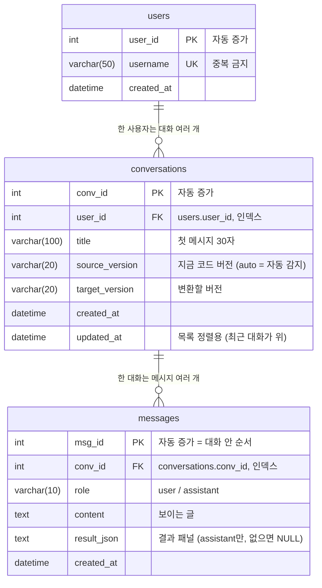

# DB 설계 (4번 · 화면 UI + DB)

> 코드: [`src/ui/db.py`](../src/ui/db.py) · 저장소: TiDB (MySQL 호환), 접속 정보가 없으면 SQLite

## ERD

## 테이블을 이렇게 나눈 기준

**기준: "한 번 생기면 몇 개씩 늘어나는가"** (1 : N 관계마다 테이블 하나)

| 테이블 | 무엇 하나가 한 줄인가 | 왜 따로 두나 |
|---|---|---|
| `users` | 사람 한 명 | 사람 정보는 대화가 몇 개든 **한 번만** 저장. username 중복 금지를 DB가 직접 막을 수 있음 (UNIQUE) |
| `conversations` | 사이드바의 대화 하나 | 사이드바 목록은 **제목 · 시각만** 필요. 메시지를 다 읽지 않고 목록을 빨리 보여 줌. 그 대화의 버전 선택도 여기에 |
| `messages` | 말풍선 하나 | 대화 하나에 메시지가 계속 늘어남. 순서대로 다시 그려야 하고, 결과 패널도 다시 띄워야 함 |

한 테이블에 다 넣으면(예: 메시지마다 username · 대화 제목을 반복) 같은 값이 수백 번 반복되고, 이름 하나 바꾸려면 모든 줄을 고쳐야 합니다. 나누면 각 값이 **한 곳에만** 있습니다 (정규화).

## 설계에서 정한 것

| 정한 것 | 이유 |
|---|---|
| 키는 `user_id`(숫자), username은 따로 UNIQUE | 회의 결정. 이름이 바뀌어도 대화 연결(FK)은 그대로 |
| 비밀번호 없음 (username만) | 회의 결정 (닉네임 방식). 대신 **내 user_id의 대화만** 불러오도록 코드에서 막음 (`get_messages`가 주인 확인) |
| 버전은 `conversations`에 | 대화를 시작할 때 고른 버전. 메시지마다 다르게 바꾸는 경우는 결과(`result_json`)의 `source_version` · `target_version`에 남음 |
| 결과 패널은 `messages.result_json`(JSON 글자) | 결과 모양(변경표, 근거, 검증)이 1 · 3번 챗봇에 따라 아직 바뀔 수 있음. 표로 쪼개면 모양이 바뀔 때마다 DB도 바꿔야 해서, 지금은 통째로 저장 |
| `updated_at` | 사이드바 "최근 대화가 위"로 정렬 |
| `user_id`, `conv_id`에 인덱스 | 목록 · 메시지를 불러올 때 이 열로 찾음 |
| 테이블은 화면이 처음 켜질 때 자동 생성 | TiDB에는 데이터베이스만 만들어 두면 됨 (`create_all`) |

## 나중에 바꿀 수 있는 것

| 상황 | 바꿀 것 |
|---|---|
| 평가 결과를 DB로 모으고 싶을 때 | `result_json`의 검증 결과(성공 여부, 시도 횟수)를 열로 꺼내기 |
| 로그인을 강하게 해야 할 때 | `users`에 비밀번호 해시 열 추가 |
| 대화 삭제 기능 | `conversations`에 `deleted_at` (지워도 기록은 남김) |

## 저장 위치 (접속 정보가 없을 때)

| 실행 위치 | secrets 에 `[tidb]` 있음 | 없음 |
|---|---|---|
| 내 컴퓨터 | TiDB | `data/local_chat.db` (SQLite, 내 컴퓨터에 계속 남음) |
| Streamlit Cloud 배포 | TiDB | SQLite 이지만 **앱이 다시 시작되면 사라짐** (배포 서버의 파일은 임시) |

→ 지금 배포 화면은 TiDB · OpenAI 키 없이도 **동작은 합니다**. 다만 대화 기록은 재시작 때 사라지고, 연상 질문은 안 나옵니다. 앱 설정 → Secrets 에 값을 넣으면 그때부터 TiDB 에 남습니다 (코드 수정 없이).
