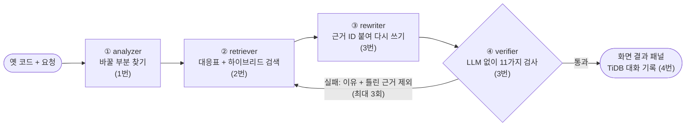
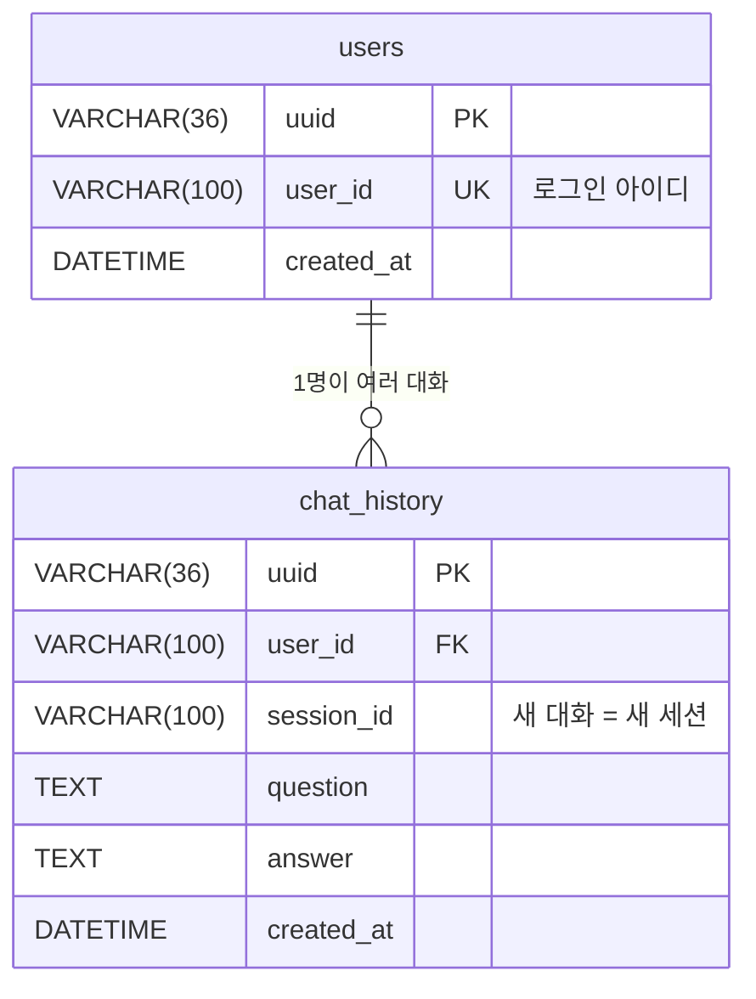

> **README 초안 (4번 작성, 2026-10-14)** · 팀 저장소 README는 1번이 관리합니다. 필요한 부분을 골라 README에 옮겨 주세요. 배포용 완성본은 [langchain-migration-assistant](https://github.com/SKN35shimsungwook/langchain-migration-assistant)에 있습니다.

<div align="center">

# LangChain 버전 마이그레이션 코드 어시스턴트

**옛 버전 LangChain 코드를 넣으면, 원하는 버전에서 돌아가는 코드로 고치고 근거와 검사 결과까지 보여 주는 챗봇**


[구조](#3-시스템-구조) · [화면 · DB](#4-화면과-대화-기록-4번) · [평가](#5-평가-방법) · [결과](#6-결과) · [실행](#9-실행-방법) · [배포 저장소](https://github.com/SKN35shimsungwook/langchain-migration-assistant)

</div>

<!-- 데모 GIF 자리: 화면에서 확인용 예제를 보내 결과 패널이 나오는 15초 녹화를 docs/images/demo.gif 로 넣고 아래 주석을 풀어 주세요
<p align="center"></p>
-->

> **문서 근거**(import · 메서드 대응표, 최신 공식 문서 검색)로 고치고, **검사 근거**(verifier 11가지, LLM 없이)로 확인합니다.
> 검사에 실패하면 실패 이유를 들고 근거를 다시 찾아 최대 3번 고칩니다. 바뀐 줄마다 근거 ID가 붙습니다.

| | |
|---|---|
| 과제 주제 | LLM을 연동한 내외부 문서 기반 질의응답 시스템 |
| 팀 | SKN35 3rd 4Team |
| 발표 | 2026-10-15 |
| 팀 저장소 | [SKNETWORKS-FAMILY-AICAMP/SKN35-3rd-4Team](https://github.com/SKNETWORKS-FAMILY-AICAMP/SKN35-3rd-4Team) |

## 진행 상황 (2026-10-15 발표 당일 기준)

| 구분 | 내용 | 상태 |
|---|---|---|
| 근거 데이터 (2번) | import 대응표 9,155줄 · 메서드 대응표 42개 · 공식 문서 295개 → 청크 11,945개 (Chroma Cloud) | ✅ 완료 |
| 그래프 (1번) | analyzer → retriever → rewriter → verifier, 실패하면 최대 3회 다시 | ✅ 동작 |
| 질문 분류 (1번) | 최상위 그래프 `supervisor()`: 코드 변환(migration) · LangChain 질문(search) · 일반 질문(general) | ✅ 동작 · 화면 연결 |
| 변환 · 검증 (3번) | rewriter(근거 ID · 이유), verifier 11가지 검사 | ✅ 동작 |
| 화면 · DB (4번) | 로그인 · 세션 저장 · 진행 단계 실시간 표시 · 결과 패널(전후 비교 · 변경 사항 · 근거 · 검사 결과 · 코드 받기) · 다시 시도 · 확인용 예제 30개, TiDB 저장 | ✅ 최상위 그래프 연결, 자동 점검 19/19 |
| 평가 (4번) | 질문 36개 (1.x로 올리기 30 + 버전 오가기 6), 질문 세트 검사 36/36 | ✅ 준비 완료 |
| 비교 실험 | 일반 LLM vs 우리 챗봇, 질문 30개 | ⏳ 결과 입력 전 |

---

## 1. 문제: 버전 지체 환각

LangChain은 1.0에서 패키지가 나뉘고, 옛 체인과 에이전트(`LLMChain`, `initialize_agent` 등)가 빠졌습니다.
그런데 인터넷에 쌓인 코드는 대부분 옛 버전이라, LLM은 복잡한 질문일수록 옛 버전 코드를 답합니다.

```text
# LangChain 1.4.4에서 실행한 결과
from langchain.chat_models import ChatOpenAI   → ImportError: cannot import name 'ChatOpenAI'
from langchain.chains import LLMChain          → ModuleNotFoundError: No module named 'langchain.chains'
```

더 큰 문제는 **LLM이 자기 답이 틀렸다는 것을 모른다**는 점입니다.
연구에서도 문서가 부족하면 LLM 코드의 42.55%만, 구조화된 문서를 줘도 66.36%만 목표 버전에서 실행됩니다. ([When LLMs Lag Behind, 2026](https://arxiv.org/abs/2604.09515))

## 2. 해결: 근거로 고치고, 검사로 한 번 더

| 구분 | 일반 LLM | 우리 챗봇 |
|---|---|---|
| 근거 | 학습 데이터 (옛 버전이 다수) | import · 메서드 대응표 + 최신 공식 문서 검색 (RAG) |
| 확인 | 없음 | verifier가 LLM 없이 11가지 검사 |
| 틀렸을 때 | 모름 | 실패 이유로 근거를 다시 찾고, 틀린 근거는 빼고 다시 고침 (최대 3회) |
| 답변 | 코드만 | 고친 코드 + 바뀐 줄마다 근거 ID · 이유 + 시도 횟수 + 설치할 패키지 |
| 버전 | 대부분 최신으로만 | 질문에 적은 버전으로 (적지 않으면 최신 1.4.5), 옛 버전으로 되돌리기 포함 |

## 3. 시스템 구조



| 단계 | 하는 일 | 담당 |
|---|---|---|
| 질문 분류 | 코드 변환(migration) · LangChain 질문(search, 문서 검색으로 답) · 일반 질문(general)으로 나눔 | 1번 |
| ① analyzer | 질문에서 코드를 뽑고 바꿀 부분 찾기 (LLM) | 1번 |
| ② retriever | import · 메서드 대응표 정확 매칭 + 문서 하이브리드 검색(BM25 + 벡터), 재시도 때 틀린 근거 제외 | 2번 |
| ③ rewriter | 근거를 보고 코드 다시 쓰기, 바뀐 줄마다 근거 ID · 이유 | 3번 |
| ④ verifier | LLM 없이 11가지 검사, 실패하면 ②로 | 3번 |
| 화면 · DB · 평가 | Streamlit 화면, TiDB 대화 기록, 평가 질문 · 점검 도구 | 4번 |

**근거 데이터 (2번)**: import 대응표 9,155줄(`imap-…`) · 메서드 대응표 42개(`mmap-…`) · 공식 문서 최신 271개 + 옛 가이드 24개 → 검색용 조각 11,945개(`doc-…`, Chroma Cloud, text-embedding-3-small) · 버전별 도구 목록 23개

**verifier 11가지 (3번)**: ① 문법 ② 근거 ID(이번에 보여 준 근거만) ③ 변경 기록(기록 없는 변경 = 환각) ④ 남은 옛 import ⑤ import 존재 ⑥ 남은 옛 메서드(경고) ⑦ 안 쓰는 import ⑧ 반환값 보존 ⑨ 정의 안 된 이름 ⑩ 출력 꺼내기 ⑪ 체인 입출력 키

## 4. 화면과 대화 기록 (4번)

| 화면 | 내용 |
|---|---|
| 로그인 | 아이디로 들어오기 (한글 · 영문 · 숫자 · _ 2~20자, **가입 때 중복 검사**) |
| 사이드바 | ChatGPT처럼 새 대화 · 내 대화 목록 · **확인용 예제 30개** · 연결 상태 배지 |
| 질문 | 코드 · 질문을 그대로 입력. 바꿀 버전은 글에 적음(예: "0.2로 되돌려 줘"), 없으면 최신 1.4.5 |
| 진행 표시 | 기다리는 동안 "① 바꿀 부분 찾음 → ② 근거 찾음 → ③ 고침 → ④ 검사 1회차 실패 → 다시…"가 실시간으로 |
| 결과 패널 | 배지(검증 통과 · N회, 원래 버전 → 바꾼 버전), 변환 기록, 탭: **전후 비교**(지운 줄 빨강 · 새 줄 초록) · **변경 사항**(옛 줄 → 새 줄 + 까닭) · **근거**(출처 · 경로 · 문서 링크) · **검사 결과**(11가지 통과 · 경고 · 실패) · **코드 받기**(.py · 변경 리포트 .md) |
| 실패했을 때 | "같은 요청으로 다시 시도" 버튼 |



- 질문 하나와 그 답이 `chat_history` 한 행. 대화 목록은 `session_id`로 묶어서 보여 줌
- TiDB 접속 정보가 없거나 틀리면 화면이 멈추지 않고 로컬 저장으로 넘어가며 이유를 표시
- 모든 질문을 팀 최상위 그래프(`supervisor`)로 보냄. 챗봇에 연결할 수 없으면 화면이 대응표로 만든 임시 결과를 보여 줌

## 5. 평가 방법

같은 질문 30개를 **일반 LLM**과 **우리 챗봇**에 넣고, verifier와 같은 기준으로 채점해 비교합니다.

| 유형 (각 3개) | 쉬움 | 중간 | 어려움 |
|---|---|---|---|
| import 경로 · 문서 로더 · 임베딩 · LLMChain → LCEL · 체인 조합 · RAG · 메모리 · 에이전트 · 출력 파서 · 실무 상황 | 7 | 15 | 8 |

- **질문**: 실제 사용자처럼 "요청 문장 + 옛 코드". 30개 모두 옛 코드가 1.x에서 깨지고 기대 import가 1.x에서 되는지 미리 확인 (36/36, 버전 오가기 6개 포함)
- **공정성**: 같은 [모델명], temperature 0, 같은 입력, 같은 채점 기준. 우리 챗봇만 최대 3회
- **지표**: 검증 통과율 · 근거 포함률(근거 ID가 붙은 바뀐 줄 비율) · 재시도 효과(최종 − 1회차, %p)

## 6. 결과

**실제 실행 사례** (2026-10-14): 0.0.300 `LLMChain` 코드를 화면 경로로 팀 그래프에 보냄 → 두 번 실행해 **두 번 모두 3회차 통과**

```python
# 변경 전                                          # 변경 후 (팀 그래프)
from langchain.chat_models import ChatOpenAI       from langchain_openai import ChatOpenAI
from langchain.prompts import PromptTemplate       from langchain_core.prompts import PromptTemplate
from langchain.chains import LLMChain              from langchain_core.output_parsers import StrOutputParser
chain = LLMChain(llm=llm, prompt=...)              chain = PromptTemplate.from_template(...) | llm | StrOutputParser()
print(chain.run(word='크다'))                       print(chain.invoke({'word': '크다'}))
```

바뀐 6줄 모두 근거 ID(`imap-…`, `mmap-…`, `doc-…`) · 못 바꾼 줄 0 · 한 번 변환에 약 1분

**비교 실험** ⏳ 결과 입력 전

| 시스템 | 검증 통과율 | 쉬움 | 중간 | 어려움 | 근거 포함률 |
|---|---|---|---|---|---|
| 우리 챗봇 | [__]% | [__]% | [__]% | [__]% | [__]% |
| 일반 LLM | [__]% | [__]% | [__]% | [__]% | - |

- 1회차 [__]% → 최종 [__]% · **재시도 효과 +[__]%p**

**화면 · 데이터 점검**: 화면 · DB 자동 점검 **19/19** · 질문 세트 검사 **36/36** · TiDB 저장 · 아이디 중복 검사 확인

## 7. 만들면서 발견한 것

- **`langchain-community`는 import만 해도 지원 종료 경고를 냅니다.** 지금 통과해도 곧 깨질 수 있습니다.
- **`langchain_classic`으로 우회하면 옛 체인도 import됩니다.** 최신 방식(LCEL)은 아니므로 대응표 · 화면에 "옛 창고(classic)"로 따로 표시합니다.
- **옛 버전끼리는 거의 그대로입니다.** 0.0.300 ~ 0.3.30 사이에는 자주 쓰는 import 경로가 거의 같고, 크게 바뀌는 것은 1.x와의 사이입니다. (버전별 도구 목록 23개 비교)

## 8. 한계와 다음 단계

| 한계 | 다음 단계 |
|---|---|
| 11가지 코드 검사까지 하지만, 바뀐 코드의 실제 실행 결과는 확인하지 않음 | 가짜 LLM을 넣어 코드 전체 실행 테스트 |
| 옛 버전으로 되돌리기는 아직 검사 통과율이 낮음, 상관없는 문서 예시를 베끼는 경우가 있음 (검사기가 '기록 없는 변경'으로 잡아냄) | 다시 쓰기 규칙 강화, 틀린 근거를 다음 시도에서 빼기, 상관없는 문서 걸러내기 |
| 검사 · 재시도로 한 번 변환에 약 1분 | 진행 단계 표시, 쉬운 import는 대응표만으로 바로 답하기 |
| 다시 연 대화는 질문 · 답만 (ERD에 결과 열 없음) | 필요하면 결과 열 추가를 팀과 협의 |
| 질문 30개 · LangChain만 대상 | 실사용 코드로 확장, 다른 라이브러리로 확장 |

## 9. 실행 방법

Windows PowerShell 5.1은 `&&`를 쓸 수 없으니 **한 줄씩** 실행합니다.

```powershell
git clone -b dev https://github.com/SKNETWORKS-FAMILY-AICAMP/SKN35-3rd-4Team.git
```

```powershell
cd SKN35-3rd-4Team
```

```powershell
uv sync
```

```powershell
uv pip install -r requirements.txt
```

`.env`에 비밀 값을 넣습니다 (Git에 올리지 않음).

```text
OPENAI_API_KEY=...
CHROMA_API_KEY=...
CHROMA_TENANT=...
CHROMA_DATABASE=...
TIDB_HOST=...
TIDB_PORT=4000
TIDB_USER=...
TIDB_PASSWORD=...
TIDB_DATABASE=langchain_db
```

| 실행 | 명령 |
|---|---|
| 화면 (4번) | `uv run streamlit run streamlit_app.py` |
| 그래프 시험 (1번) | `uv run python app.py` |
| 노드별 시험 (3번) | `uv run python check_nodes.py` |

### 점검 재현

```bash
uv run python tools/bot_check.py
```

```bash
uv run python eval/check_questions.py --py <LangChain 1.x python> --map data/processed/import_map.jsonl --symbols data/raw/symbols
```

`bot_check.py`는 임시 SQLite로 화면을 실행해 19가지를 확인합니다(TiDB · 유료 API 사용 안 함). 마지막 줄 `19/19 통과`가 정상입니다.

## 10. 폴더 구조

```text
├── streamlit_app.py        # 4번 화면 입구 (app.py 는 1번의 그래프 실행 시험용)
├── app.py · check_nodes.py # 1번 · 3번 시험 스크립트
├── src/
│   ├── graph/              # 1번 · 3번: graph.py(질문 분류 입구) · supervisor.py(변환 파이프라인) · state.py · nodes/
│   ├── prompt/             # 1번 · 3번: analyzer · rewriter · classifier 프롬프트
│   ├── rag/                # 2번: 문서 수집 · 대응표 · 청킹 · 임베딩 · 검색
│   └── ui/                 # 4번: client.py(그래프 호출 · 진행 표시) · result_view.py(결과 패널) · db.py(TiDB) · mock.py(그래프 없을 때)
├── data/                   # 2번: processed/(대응표 · 청크) · raw/(문서 · 버전별 도구 목록)
├── eval/                   # 4번: questions.json(36개) · build_questions.py · check_questions.py
├── tools/bot_check.py      # 4번: 화면 · DB 자동 점검 19가지
└── docs/                   # 4번: 화면 실행 방법 · DB 설계(ERD) · 머지 가이드 · 결과 모양
```

## 11. 문서

| 문서 | 내용 |
|---|---|
| [docs/화면_실행방법.md](화면_실행방법.md) | 화면 실행 · 비밀 값 · 자동 점검 · 자주 나는 문제 |
| [docs/DB_설계.md](DB_설계.md) | ERD (users, chat_history), 화면이 DB를 쓰는 방법, 이전 설계 |
| [eval/README.md](../eval/README.md) | 평가 질문 36개 구성과 검사 방법 |
| [docs/머지_가이드.md](머지_가이드.md) | 팀 저장소와 겹치는 파일, 가져갈 기능 · 뺄 기능 |
| 발표 자료 · 테스트 계획 및 결과 보고서 | 발표 당일 제출본 (PPT · PDF) |

## 12. 팀

공개 저장소라서 팀원은 **역할 번호로만** 적습니다.

| 역할 | 담당 |
|---|---|
| 1번 | 그래프 · 백엔드 (LangGraph 연결, 질문 분류, analyzer, 재시도 판단, dev 병합) |
| 2번 | 데이터 · 검색 (문서 수집, import · 메서드 대응표, 청킹, Chroma, 하이브리드 검색, retriever) |
| 3번 | 변환 · 검증 (State, rewriter, verifier 11가지 검사) |
| 4번 | 화면 · DB · 평가 (Streamlit 화면, TiDB 대화 기록, 평가 질문 36개 · 점검 도구) + 보고서 · README · 발표 |

## 13. 참고 자료

- [LangChain v1 마이그레이션 가이드](https://docs.langchain.com/oss/python/migrate/langchain-v1)
- Ashik et al., [When LLMs Lag Behind: Knowledge Conflicts from Evolving APIs in Code Generation](https://arxiv.org/abs/2604.09515), 2026
- [GitChameleon 2.0: Evaluating AI Code Generation Against Python Library Version Incompatibilities](https://arxiv.org/abs/2507.12367), 2025
- Wu et al., [VersiCode: Towards Version-controllable Code Generation](https://arxiv.org/abs/2406.07411), 2024
