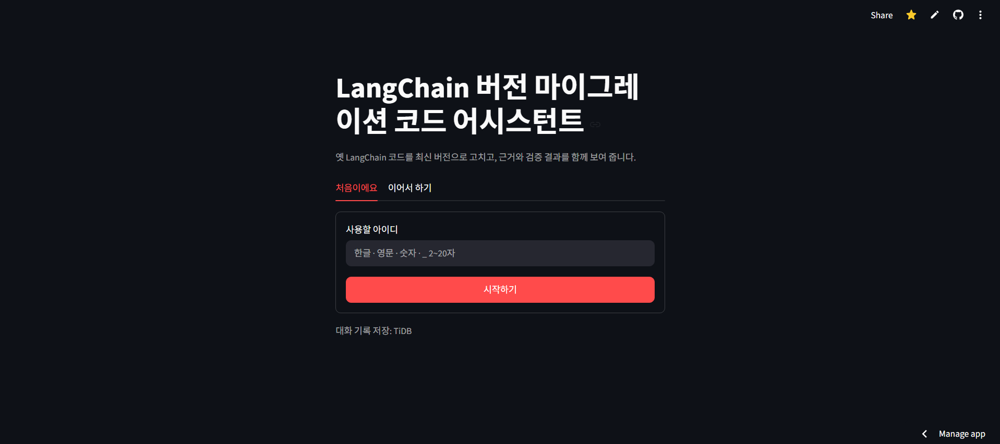
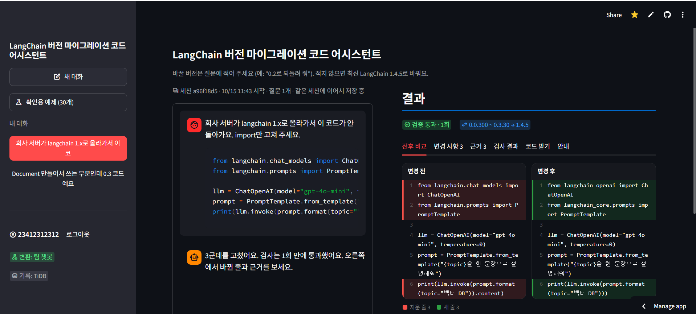
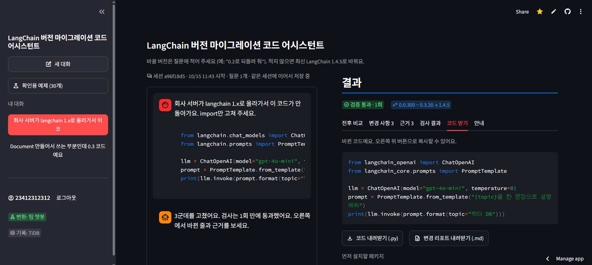
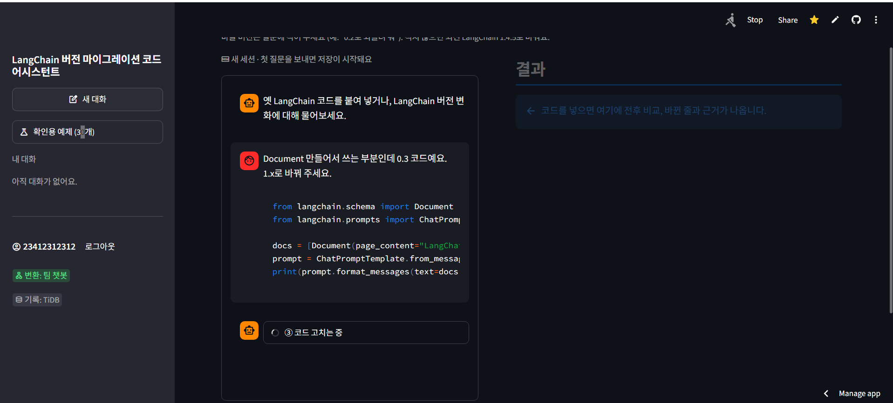
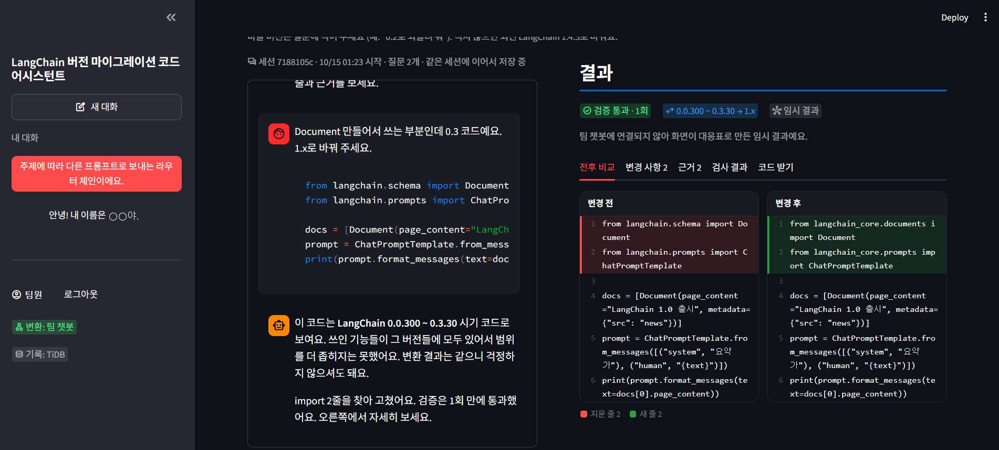
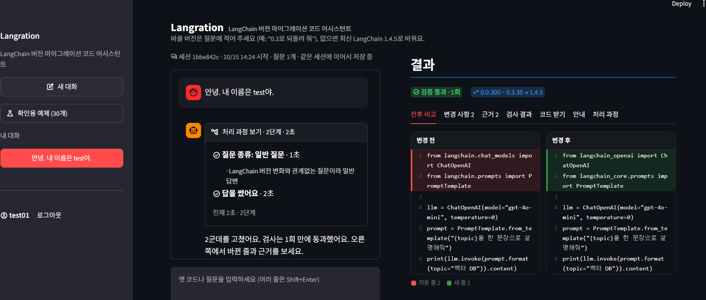

# 작업 기록 · Langration (LangChain 버전 마이그레이션 코드 어시스턴트)

> 4번(화면 · DB · 평가 · 발표)이 AI 코딩 도우미(Claude Code)와 대화하며 진행한 작업을 **대화 순서대로** 정리한 기록입니다 (2026-10-12 ~ 10-15).
> 팀원은 역할 번호로만 적습니다. 1번 그래프 · 백엔드 / 2번 데이터 · 검색 / 3번 변환 · 검증 / 4번 화면 · DB · 평가 · 발표
> 이 과정에서 만든 보조 파일은 [작업기록/](../작업기록/), 설계 · 트러블슈팅 전체는 [프로젝트_최종_보고서.md](프로젝트_최종_보고서.md)에 있습니다.

## 1. 프로젝트 정보

| 항목 | 내용 |
|---|---|
| 서비스 이름 | **Langration** (LangChain 버전 마이그레이션 코드 어시스턴트) |
| 과제 | SKN35 · LLM을 연동한 내외부 문서 기반 질의응답 시스템 |
| 팀 | SKN35 3rd 4Team, 4명 (역할 1 ~ 4번) |
| 기간 · 발표 | 2026-10-12 ~ 2026-10-15 (발표 10-15) |
| 한 줄 설명 | 옛 버전 LangChain 코드를 원하는 버전에서 돌아가는 코드로 고치고, 근거(대응표 · 공식 문서)와 LLM 없는 11가지 검사 결과까지 보여 주는 챗봇 |
| 핵심 결과 | 같은 gpt-4o-mini로 공통 기준 통과 **일반 LLM 0% → 우리 챗봇 57%** (실행 기준 0% → 87%), 자체 평가 83.3점 (B) |
| 기술 | Python 3.12 · LangChain 1.x(1.4.5) · LangGraph · OpenAI(gpt-4o-mini, text-embedding-3-small) · Chroma Cloud · TiDB Cloud · Streamlit |
| 배포 화면 | https://langchain-migration-assistant-btn5chcr8ragnwts68rmhf.streamlit.app |

### 저장소

| 저장소 | 역할 | 비고 |
|---|---|---|
| [SKNETWORKS-FAMILY-AICAMP/SKN35-3rd-4Team](https://github.com/SKNETWORKS-FAMILY-AICAMP/SKN35-3rd-4Team) | 팀 저장소 | 4번은 `sungwook` 브랜치에서 작업, dev에는 웹 파일만 (문서 · 자료 · md는 넣지 않음) |
| [SKN35shimsungwook/langchain-migration-assistant](https://github.com/SKN35shimsungwook/langchain-migration-assistant) (이 저장소) | **배포용** | 팀 코드 + 화면 + 평가 + 문서 + 발표자료 + 작업기록, Streamlit Community Cloud |
| [SKN35shimsungwook/migration-chatbot-ui](https://github.com/SKN35shimsungwook/migration-chatbot-ui) | 4번 화면 개인 저장소 | 초기 화면 개발용 (10-13 ~ 10-15 오전) |
| [SKN35shimsungwook/langchain-migration-helper](https://github.com/SKN35shimsungwook/langchain-migration-helper) | 기획 · 문서 저장소 | 초기 기획, 안내서, 합의안, 회의록, 10-12 ~ 13 [작업기록](https://github.com/SKN35shimsungwook/langchain-migration-helper/blob/main/docs/작업기록.md) |

### 작업 규칙 (대화 중에 정한 것)

- 팀 저장소는 **`sungwook` 브랜치만**, 매번 요청이 있을 때 올림. dev는 요청할 때만, **웹 파일만** (발표자료 · 문서 · md 제외). 다른 팀원 파일은 고치지 않음 (예외: 팀 결정으로 `supervisor.py` 대화 맥락 유지, `.gitignore` 3줄 추가)
- 공개 문서에는 팀원 실명 대신 역할 번호
- 커밋 메시지는 한국어 `<타입>: 무엇을`, AI 공동 작성자 줄은 붙이지 않음
- `.env` · Secrets 값은 읽거나 출력하지 않음, 깃에 올리지 않음
- 옛 문서는 지우지 않고 "이전 버전"으로 남김
- 발표 자료를 만들 때 화면(UI) 코드는 요청 없이 건드리지 않음

## 2. 날짜별 기록

### 10-12 (월) · 평가 설계 시작

| 요청 | 한 일 | 결과물 |
|---|---|---|
| 평가 질문 만들기 | 실무형 질문 후보 작성, 옛 코드가 1.x에서 실제로 깨지는지 · 기대 import가 되는지 확인 | `작업기록/01_평가질문_후보_만들기` |
| 검증 평가를 팀에 설명 | "검증 평가 첫걸음" 안내서(전체 · 파트 상세) HTML · PDF, 설명 그림(SVG) | `작업기록/02_검증평가_안내서_만들기` |
| 결과 차트 미리 보기 | ⚠ 가짜 데이터로 차트 모양 · 채점 흐름 시험 (실제 결과 아님) | `작업기록/03_예시_차트_가짜데이터` |

### 10-13 (화) · 데이터 확인 · 화면 초안

| 요청 | 한 일 | 결과물 |
|---|---|---|
| 2번 데이터 확인 | 2번 브랜치 대응표 · 청크를 읽기 전용으로 분석, 새 import 경로가 실제로 되는지 시험 | `작업기록/04_2번_데이터_분석` |
| 3번과 출력 모양 맞추기 | report 모양 · 필드 · 규칙 합의안, 확인 도구(`check_contract.py`, `run_system.py`) | langchain-migration-helper `docs/출력모양_합의안.md` |
| 주간회의 | 회의록 (역할별 할 일 · 데이터 출처 · 확인할 것) | 팀 공유 |
| 화면 초안 | 버전 마인드맵 → 채팅 → 결과 패널 (가짜 결과), 화면 실행 방법 문서, Streamlit Cloud 배포 | migration-chatbot-ui, 팀 sungwook (`4dba988`) |

### 10-14 (수) · 회의 반영 · 팀 그래프 연결

| 요청 | 한 일 | 결과물 · 커밋 |
|---|---|---|
| 회의 결과 반영 | ChatGPT형 화면(새 대화 · 내 대화 목록), 세션 저장, 평가 질문 | sungwook `526af4f` |
| `app.py` 충돌 | 화면 입구를 `streamlit_app.py`로 분리, `app.py`는 1번 것 그대로 | `8de950f` |
| 팀 ERD 확정 | `users` · `chat_history`로 저장 변경, 가입 때 아이디 중복 검사 | `43aa17d` |
| TiDB 연결 | `.env` 안내, 접속 실패 · 예시 값이면 로컬 저장 + 이유 표시 | `b0e37a6` |
| 팀 그래프 연결 | 가짜 결과 → 실제 그래프 결과, 확인용 예제 30개 (LLMChain 예제 2회 모두 3회차 통과) | `bb45373` |
| 배포 | 배포 저장소 생성, Streamlit Cloud "Missing credentials" 해결 (Secrets를 먼저 읽기 · 성공만 캐시), `uv.lock` 제외 | `1b1a18c`, 배포 저장소 |
| README · 발표 · 보고서 | README 초안, 발표 PPT v1 · v2, 대본, 테스트 계획 및 결과 보고서 초안 | `bc8af85`, `작업기록/06 · 07 · 08` |

### 10-15 (목) 오전 · 최상위 그래프 · 결과 패널 · 평가

| 요청 | 한 일 | 결과물 · 커밋 |
|---|---|---|
| dev 최신 합치기 | 1번 최상위 그래프(`supervisor`) · 2번 목표 버전 반영, 화면 입구를 `supervisor()`로, 버전 선택 상자 제거 | `556e237` |
| 결과 패널 개편 | 배지 "원래 버전 → 바꾼 버전", 탭(전후 비교 빨강 · 초록 · 변경 사항 · 근거 · 검사 결과 · 코드 받기 · 안내), 근거 ID 코드 · "이유" 라벨 제거, 진행 단계 실시간 표시, 다시 시도 버튼 | `556e237` |
| 환각 실패 분석 | ChatCerebras 줄이 생겨 3회 실패: 검색이 상관없는 문서를 주고 rewriter가 예시를 베낌, 검사기는 정확히 잡음 | `작업기록/11` `cerebras_state.json` |
| 발표 PPT v3 · v4 | 애플 플랫(v3), v2 디자인 + 당일 업데이트(v4, 19장), 대본 Word | `발표자료/` |
| 실제 평가 | 질문 50개를 챗봇 · 일반 LLM에 실행, LLM 없이 채점 (공통 8항목 · 자체 21항목), 진행 화면 | `eval/run_eval.py`, `eval/score.py`, sungwook `a20ecb7` |
| 강점 중심 정리 | 발표 14 · 15장 차트, 약점 · 개선 방안, README · 보고서 결과 채우기 | `docs/평가_결과와_개선방안.md` |
| 9장 화면 캡처 | localhost에서 확인용 예제 q11 통과 화면 캡처 | `docs/images/…screen.jpg`, `d57b938` |
| 프로젝트 최종 보고서 | 설계 · 파일 구조 · 데이터 · 화면 · 역할별 작업 기록과 트러블슈팅 · 평가 · 의의 (PDF · Word · md), 발표 부록 3장 | `5cf96a3` |

### 10-15 (목) 오후 · dev 반영 · 화면 다듬기 · 대화 맥락

| 요청 | 한 일 | 결과물 · 커밋 |
|---|---|---|
| dev에 웹 올리기 | 최신 dev 위에 웹 파일만 (`streamlit_app.py`, `src/ui/`, `requirements.txt`, `.gitignore` 3줄), 예제 파일 없으면 예제 칸만 숨김 | dev `21fdd29` |
| dev 실행 방법 | `uv sync` → `uv pip install -r requirements.txt` → `streamlit run streamlit_app.py`, requirements에 그래프 패키지 추가 | dev `732ef22` |
| 처리 과정 자세히 | 단계마다 세부 내용(찾은 줄 · 근거 · 바뀐 줄 · 걸린 검사), 진행 상자가 접히던 문제, 답 위 "처리 과정 보기" · 결과 탭 | `311689a`, dev `c8438a8` |
| 연결 배지 제거 | "변환: 팀 챗봇 / 기록: TiDB" 제거, 문제 있을 때만 이유 한 줄 | `1ea02e2` |
| 팀원 화면 "임시 결과" | 같은 dev 코드가 이 컴퓨터에서는 정상 → 팀원 환경 문제로 진단, 오류 원인을 답 · 터미널에 표시 | `c27de69` |
| 예제 dev에 | `eval/questions.json`만 dev에 추가 | dev `70fff7f` |
| 이름 · 레이아웃 | 앱 이름 **Langration**, 입력창 크게(높이 140), 맨 위 빈 공간 · 제목을 한 줄로 | dev `ba75907` |
| 3번 verifier 반영 | 평가에서 찾은 `result["text"]` 빈틈을 3번이 수정 → 배포에 반영 | 배포 `b24056a` |
| TiDB 정리 | 시험 계정 29개 · 대화 46개 삭제(백업 후), 팀원 아이디 2개 유지 | `작업기록/10_TiDB_관리` |
| 발표 6장 대본 | 검증 두 가지(답마다 · 챗봇 자체) 다듬기, 같은 모델 · RAG · 프롬프트 · 검사 차이 | 대본 |
| 인사에 이전 결과가 나옴 | 1번의 체크포인터 시험 버전에서 앞 질문 상태가 남음 → 답 종류를 이번 질문 분류로, `thread_id` 전달 | `3135772` |
| **대화 맥락 유지** | `supervisor`에 `MemorySaver`, 세션별 `thread_id`, 질문별 값 비우기, 일반 답변에 앞 대화 12개 | dev `a9d6970`, sungwook `4ee4266`, 배포 `007c9f8` |
| 친근한 안내 (배포만) | 첫 인사 "안녕하세요, Langration입니다! 👋", 답변 중 "Langration이 생각 중입니다…" | 배포 `018454d` |
| 기록 정리 | 이 작업 기록, 작업기록 폴더(보조 파일 전체), 보고서 · README 최신화 | 이 커밋 |

### 2-1. 화면 기록 (사진, 10-15)

화면이 바뀌어 온 과정과 실제로 겪은 문제를 사진으로 남깁니다. 문제 사진의 해결 방법은 7-4 트러블슈팅에 있습니다.

**바뀌어 온 과정**

| 사진 | 무엇 |
|---|---|
|  | ① 로그인 (이름을 바꾸기 전: "LangChain 버전 마이그레이션 코드 어시스턴트", 아래 "대화 기록 저장: TiDB") |
|  | ② 배포 화면에서 확인용 예제(import 고치기)를 보내 **1회 만에 검증 통과**, 0.0.300 ~ 0.3.30 → 1.4.5, 전후 비교 빨강 · 초록 (사이드바에 연결 배지가 있던 때) |
|  | ③ 결과 패널 "코드 받기" 탭: 바뀐 코드 복사, `.py` · 변경 리포트 `.md` 내려받기, 먼저 설치할 패키지 |
|  | ④ 발표 9장에 넣은 화면: 확인용 예제 q11(LLMChain → LCEL) **2회차에 검증 통과** |

**실제로 겪은 문제**

| 사진 | 문제 | 원인 → 해결 |
|---|---|---|
|  | ⑤ 기다리는 동안 "③ 코드 고치는 중" **제목만 보이고 세부 내용이 안 보임** | 단계마다 제목만 바꾸면 상자가 접힘 → `status.update(..., expanded=True)`, 단계마다 세부 내용 추가 |
|  | ⑥ 팀원 화면에서 배지는 "팀 챗봇"인데 결과는 **"임시 결과"** (대응표로 만든 대체 결과) | 그래프 실행 중 오류, 같은 dev 코드가 이 컴퓨터에서는 정상 → 팀원 환경 문제. 오류 원인을 답 맨 위 · 터미널에 표시 |
|  | ⑦ "안녕. 내 이름은 test야."에 처리 과정은 "일반 질문"인데 **답은 이전 코드 변환 결과** | 체크포인터(대화 기억) 시험 버전에서 앞 질문 상태가 남음 → 답 종류를 이번 질문 분류로, 질문마다 변환 값 비우기, 세션별 thread_id |

## 3. 중요한 결정

| 결정 | 이유 |
|---|---|
| 검사는 LLM 없이 코드로 (11가지) | 검사하는 LLM도 같은 옛 지식을 가짐 |
| 화면이 결과를 State에서 바로 읽음 (별도 report 노드 없음) | 노드 하나를 줄이고 화면이 그래프 결과를 그대로 보여 줌 |
| 바꿀 버전은 질문에서 읽음 (선택 상자 제거) | 2번 `target_version`과 중복 |
| 평가는 LLM 없이 코드로 채점, 공통 8항목 + 자체 21항목 | 사람 · LLM 판정의 주관 없이, 몇 번 채점해도 같은 점수 |
| 강점 중심 발표, 약점은 숫자 · 원인 · 개선 순서로 | 같은 모델로 0% → 57%가 핵심, 약점은 숨기지 않음 |
| dev에는 웹 파일만 | 팀 저장소 문서 · 자료와 섞지 않음 |
| 대화 맥락은 체크포인터 + 질문별 초기화, 파이프라인 구조는 그대로 | 파이프라인을 감싸는 방식은 통과율이 낮아져(원래 3/4 → 1/5) 버림 |

## 4. 현재 상태와 남은 일

| 항목 | 상태 |
|---|---|
| 화면 · 그래프 · 평가 · 문서 · 발표 | ✅ dev · sungwook · 배포 코드 일치 (배포만 친근한 안내 문구 추가) |
| 개선 ① 분류 규칙 (1번) | ⬜ |
| 개선 ② 환각 · 근거 누락 (3 · 1번) | ⬜ |
| 개선 ③ 검사기 `['text']` 빈틈 (3번) | ✅ 10-15 |
| 개선 ③ 목표 버전별 검사 (3 · 2번) | ⬜ |
| 개선 ④ classic 우회 (2 · 3번) | ⬜ |
| 대화 기억 | ✅ 일반 답변. 서버 메모리라 재시작하면 사라짐, 검색 · 변환은 이번 질문만 봄 |
| 추천 질문 · 단계별 지표(Hit@k 등) | ⬜ |
