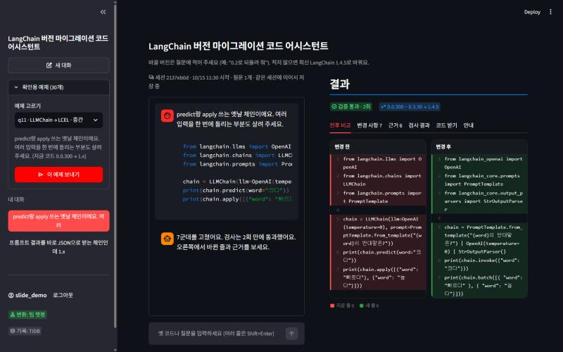
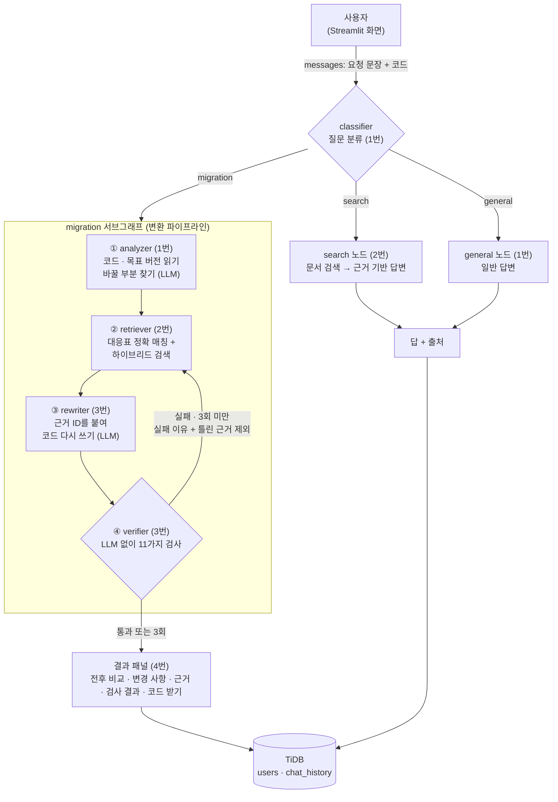
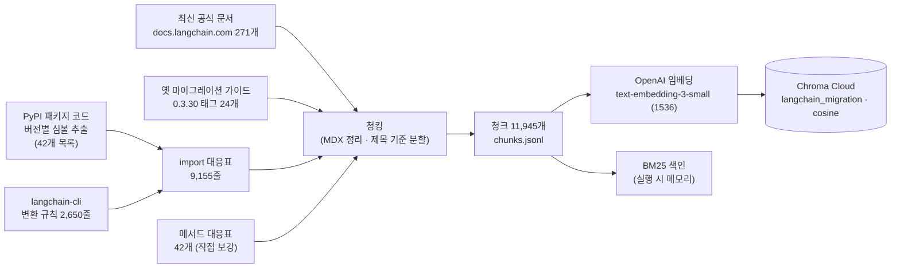
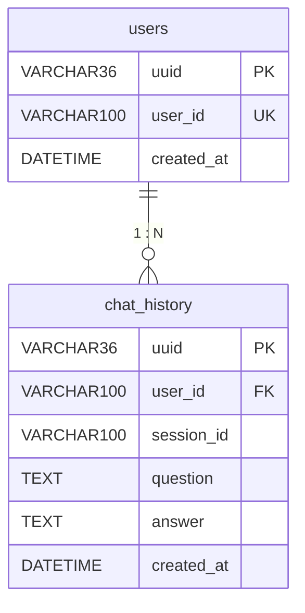

# LangChain 버전 마이그레이션 코드 어시스턴트 · 프로젝트 최종 보고서

> SKN35 3rd 4Team · 2026-10-15 · 작성 4번 (각 역할의 기록은 커밋 · PR · 코드 주석 · PLAN.md · 회의 기록 · 실행 기록에서 모음)
> 이름 대신 역할 번호로 적습니다. 1번 그래프 · 백엔드 / 2번 데이터 · 검색 / 3번 변환 · 검증 / 4번 화면 · DB · 평가 · 발표

## 목차

0. [요약](#0-요약)
1. [프로젝트 개요](#1-프로젝트-개요)
2. [문제 정의: 버전 지체 환각](#2-문제-정의-버전-지체-환각)
3. [시스템 설계 (LLM + RAG)](#3-시스템-설계-llm--rag)
4. [파일 구조](#4-파일-구조)
5. [데이터 (2번)](#5-데이터-2번)
6. [화면 · DB · 배포 (4번)](#6-화면--db--배포-4번)
7. [역할별 작업 기록과 트러블슈팅](#7-역할별-작업-기록과-트러블슈팅)
8. [팀 전체 타임라인](#8-팀-전체-타임라인)
9. [평가](#9-평가)
10. [프로젝트 의의](#10-프로젝트-의의)
11. [한계와 향후 계획](#11-한계와-향후-계획)
12. [협업 방식과 회고](#12-협업-방식과-회고)
13. [부록: 실행 방법 · 산출물 · 참고 자료](#13-부록)

---

## 0. 요약

| 구분 | 내용 |
|---|---|
| 무엇을 | 옛 버전 LangChain 코드를 넣고 원하는 버전을 말하면, 그 버전에서 돌아가는 코드로 고치고 **근거**와 **검사 결과**까지 보여 주는 챗봇 |
| 어떻게 | 질문 분류 → (바꿀 부분 찾기 → 근거 검색 → 근거를 붙여 고쳐 쓰기 → LLM 없이 11가지 검사) → 실패하면 실패 이유를 들고 최대 3회 다시 |
| 근거 | import 대응표 9,155줄 · 메서드 대응표 42개 · 공식 문서 295개 → 청크 11,945개 (Chroma Cloud) · 버전별 도구 목록 42개 |
| 결과 | 같은 gpt-4o-mini로 공통 기준 통과 **일반 LLM 0% → 우리 챗봇 57%** (실행 기준 0% → 87%), 바뀐 줄의 93%에 근거, 자체 평가 **83.3점 (B)** |
| 화면 | Streamlit 대화형 화면 · 진행 단계 실시간 표시 · 결과 패널(전후 비교 · 변경 사항 · 근거 · 검사 결과 · 코드 받기) · TiDB 대화 기록 · [배포 화면](https://langchain-migration-assistant-btn5chcr8ragnwts68rmhf.streamlit.app) |
| 의의 | 모델을 바꾸지 않고 근거와 검사로 신뢰를 만들었고, 틀릴 때 틀렸다고 알리며, 스스로 채점하는 도구로 고칠 곳을 데이터로 정함 |



*실제 화면 (2026-10-15): 확인용 예제(LLMChain → LCEL)를 보내 2회차에 검증 통과, 0.0.300 ~ 0.3.30 → 1.4.5, 바뀐 줄을 빨강 · 초록으로 비교*

---

## 1. 프로젝트 개요

| 항목 | 내용 |
|---|---|
| 과제 주제 | LLM을 연동한 내외부 문서 기반 질의응답 시스템 |
| 기간 | 2026-10-12 ~ 2026-10-15 (발표 10-15) |
| 팀 | SKN35 3rd 4Team, 4명 (역할 4개) |
| 목표 | LangChain 공식 문서 · 옛 마이그레이션 가이드 · 대응표를 청크 · 임베딩해 Chroma에 넣고, LangGraph로 질문 분류 → (analyzer → retriever → rewriter → verifier)를 잇는 RAG 챗봇 |
| 차별점 | **이중 검증**: ① 문서 근거 (바뀐 줄마다 근거 ID: 대응표 `imap-…`, 메서드 대응표 `mmap-…`, 문서 `doc-…`) ② 검사 근거 (verifier가 LLM 없이 11가지 검사, 실패하면 재시도) |
| 증명 방법 | 실무형 질문 30개를 일반 LLM과 우리 챗봇에 같은 모델로 넣고 LLM 없이 코드로 채점해 비교 + 팀 규칙 21항목 자체 평가 |

### 1-1. 역할 분담

| 역할 | 브랜치 | 맡은 영역 | 주요 파일 |
|---|---|---|---|
| 1번 | wooos | 그래프 · 백엔드: 폴더 구조, 최상위 그래프(질문 분류 → migration · search · general), 변환 파이프라인, 재시도 판단, analyzer · classifier · general, dev 병합 관리 | `src/graph/supervisor.py`, `migration.py`, `nodes/analyzer_node.py`, `classifier_node.py`, `general_node.py`, `src/prompt/analyzer · classifier · general` |
| 2번 | scy | 데이터 · 검색: 문서 수집, import · 메서드 대응표, 청킹, 임베딩, Chroma Cloud, 하이브리드 검색, retriever · search 노드, 목표 버전 판정 | `src/rag/**`, `data/`, `nodes/retriever_node.py`, `search_node.py`, `src/prompt/search_prompt.py` |
| 3번 | zozuzu | 변환 · 검증: State 설계, rewriter(근거 ID를 붙여 고쳐 쓰기), verifier(11가지 검사), 노드 점검 | `src/graph/state.py`, `nodes/rewriter_node.py`, `verifier_node.py`, `src/prompt/rewriter_prompt.py`, `check_nodes.py` |
| 4번 | sungwook | 화면 · DB · 평가 · 발표: Streamlit 화면, TiDB 대화 기록, 배포, 평가 질문 · 비교 실험 · 자체 평가, 회의록, 보고서 · README · 발표 | `streamlit_app.py`, `src/ui/**`, `eval/**`, `tools/bot_check.py`, `docs/**` |

---

## 2. 문제 정의: 버전 지체 환각

LangChain은 1.0에서 패키지가 나뉘고(`langchain-core`, `langchain-openai`, `langchain-community`, `langchain-classic` …) `LLMChain`, `initialize_agent` 같은 옛 체인 · 에이전트가 빠졌습니다. 인터넷의 코드는 대부분 옛 버전이라 LLM은 옛 방식을 답하고, 틀려도 모릅니다.

```python
# LLM이 흔히 주는 코드
from langchain.chat_models import ChatOpenAI
from langchain.chains import LLMChain
# LangChain 1.4.5에서 실행하면
# ImportError: cannot import name 'ChatOpenAI'
# ModuleNotFoundError: No module named 'langchain.chains'
```

| 근거 | 수치 |
|---|---|
| When LLMs Lag Behind (2026) | 문서가 부족할 때 LLM 코드 중 목표 버전에서 실행되는 비율 **42.55%**, 구조화된 문서를 줘도 **66.36%** |
| GitChameleon 2.0 (2025) | 최신 상용 모델의 버전 지정 코드 생성 성공률 **48~51%** |
| 우리 실험 (2026-10-15) | gpt-4o-mini 혼자서는 30개 중 29개에서 옛 import를 그대로 두고 "1.x에 맞게 수정했다"고 답함 |

→ 문서를 주는 것만으로는 부족하고, **고친 코드를 확인하는 단계**가 필요합니다.

---

## 3. 시스템 설계 (LLM + RAG)

### 3-1. 전체 구조



- 최상위 그래프: `src/graph/supervisor.py`의 `supervisor()` (`StateGraph(MigrationState)`, `classifier` → 조건 분기 `migration` · `search` · `general` → END)
- 변환 파이프라인: `src/graph/migration.py`의 `migration()` (analyzer → retriever → rewriter → verifier, `route_after_verify`가 `retry` 면 retriever로, `done` 이면 END)
- 화면은 `supervisor().stream(inputs, stream_mode=["updates", "values"], subgraphs=True)`로 단계마다 진행 상황을 받아 보여 줌 (`src/ui/client.py`)

### 3-2. 오프라인 파이프라인: 근거 만들기 (2번, 1회 실행)



| 단계 | 파일 | 하는 일 |
|---|---|---|
| 심볼 추출 | `src/rag/import_map/extract_symbols.py` | 버전별 패키지를 받아 공개 경로 · `@deprecated` 정보를 `data/raw/symbols/{패키지}-{버전}.jsonl`로 (42개) |
| CLI 규칙 | `fetch_cli_mappings.py` | langchain-cli의 공식 자동 변환 규칙 2,650줄 |
| 대응표 | `build_import_map.py` · `run_all.py` | 심볼 + CLI 규칙 병합 → 옛 경로 → 1.x 경로, 실제 import 검사 결과(`import_status`), 대안 |
| 메서드 대응표 | `manual_method_map.py` | `.run()` → `.invoke()` 같은 호출 변경 42개, 반환값 차이 Note |
| 문서 수집 | `src/rag/docs_collect/fetch_latest_docs.py` · `fetch_migration_guides.py` | 최신 Python 문서 271개 + 0.3.30 옛 가이드 24개 |
| 청킹 | `src/rag/chunking/clean_mdx.py` · `build_chunks.py` | MDX/JSX 태그 정리, 제목 기준 분할, 코드 블록 통째로, 표는 행 단위 + 머리행 반복, 최대 4,000자 · 최소 300자 (옛 가이드는 8,000자) |
| 임베딩 · 적재 | `src/rag/embedding/build_vectordb.py` | text-embedding-3-small (1536차원), Chroma Cloud 컬렉션 `langchain_migration`, cosine |
| 목표 버전 | `src/rag/import_map/version_resolve.py` | 대표 버전 10개(0.0.300 · 0.0.354 · 0.1.20 · 0.2.17 · 0.3.30 · 1.0.8 · 1.1.3 · 1.2.18 · 1.3.18 · 1.4.5) 기준으로 경로가 그대로인지 · 옮겨졌는지 · 없는지 판정 |

### 3-3. 온라인 파이프라인: 질문 하나가 지나가는 길

| 순서 | 노드 (담당) | LLM | 입력 → 출력 | 핵심 규칙 |
|---|---|---|---|---|
| 0 | classifier (1번) | gpt-4o-mini, temp 0.7 | messages → `classification` | migration > search > general, 출력은 단어 하나, 메시지 안 지시문 무시 |
| ① | analyzer (1번) | gpt-4o-mini, temp 0 | question → `old_code`, `analysis`(issues · missing_info · retrieval_queries), `target_version` | 찾기만 하고 고치지 않음, 근거 없으면 confidence 최대 medium, 목표 버전은 말한 그대로(없으면 latest → 1.4.5) |
| ② | retriever (2번) | 없음 (임베딩만) | old_code · analysis · target_version · exclude_ids → `evidences` | ① 대응표 정확 매칭(목표 버전 판정) ② 메서드 호출 정확 매칭 ③ 대응표 유사 검색 ④ 문서 하이브리드 검색(BM25 + 벡터, RRF k=60, 상위 5개, 같은 페이지 최대 2개, 정답 import를 쓰는 청크 ×1.5) |
| ③ | rewriter (3번) | gpt-4o-mini, temp 0, 구조화 출력, 2회 재시도 | old_code(줄 번호) · EVIDENCE · ANALYZER_HINTS · RETRY_FEEDBACK → `new_code`, `changes`(old · new · evidence_ids · reason), `unresolved`, `rewrite_notes`, `install_packages`, `shown_evidence_ids` | EVIDENCE에 없는 경로 · 이름을 만들지 않음, 바꾼 줄마다 근거 ID, 확신 없으면 그대로 두고 unresolved, 반환값 보존 |
| ④ | verifier (3번) | **없음** | old_code · new_code · changes · evidences · shown_evidence_ids → `verify_result`(passed · errors · warnings), `attempt`+1, `exclude_ids` | 11가지 검사, 오류는 재시도 사유 · 경고는 보고용, 3회에 닿거나 통과하면 끝 |
| - | search (2번) | gpt-4o-mini, temp 0 | messages → 답 + 출처 | CONTEXT에 있는 것만, 버전을 밝히고, "출처:" 줄 |
| - | general (1번) | gpt-4o-mini, temp 0.7 | messages → 답 | 짧게, 모르면 모른다고, 이 챗봇 기능 안내 |

### 3-4. State (`src/graph/state.py`, 3번 설계 · 2번 `target_version` 추가)

| 필드 | 쓰는 곳 → 읽는 곳 | 뜻 |
|---|---|---|
| `messages` (add_messages) | 화면 → 전체 | 대화 메시지 |
| `classification` | classifier → 분기 | migration · search · general |
| `question` | 화면 → analyzer | 사용자 글 |
| `old_code` · `analysis` · `target_version` | analyzer → retriever · rewriter · 화면 | 코드 원문, 분석 결과, 목표 대표 버전 (예: "0.2.17", 없으면 "1.4.5") |
| `evidences` | retriever → rewriter · verifier · 화면 | 근거 목록 (evidence_id, source, match, old, new, kind, import_status, alternative, text …) |
| `shown_evidence_ids` | rewriter → verifier | 이번 프롬프트에 실제로 보여 준 근거 ID (이전 ID 복사 방지) |
| `new_code` · `changes` · `unresolved` · `rewrite_notes` · `install_packages` | rewriter → verifier · 화면 | 새 코드, 변경 기록, 못 바꾼 줄, 안내, 설치할 패키지 |
| `rewrite_failed` | rewriter → verifier | LLM 호출 실패로 원본이 돌아온 경우 통과 방지 |
| `verify_result` · `attempt` | verifier → 분기 · 화면 | 검사 결과, 시도 횟수 |
| `exclude_ids` (merge_ids: 합집합 누적) | verifier → retriever | 다음 검색에서 뺄 틀린 근거 |

### 3-5. 검증 11가지 (`verifier_node.py`, 3번)

| # | 검사 | 오류 유형 | 왜 넣었나 |
|---|---|---|---|
| 1 | 문법 | `syntax_error` | 파싱이 안 되면 나머지 검사 불가 |
| 2 | 근거 ID | `missing_evidence` · `evidence_not_shown` · `unknown_evidence_id` | 이번에 보여 준 근거만 인정 (피드백에 보였던 옛 ID를 복사해도 통과하던 문제) |
| 3 | 변경 기록 | `old_line_mismatch` · `change_not_applied` · `unrecorded_change` | 기록 없이 바뀐 줄 = 근거 없는 변경 = **환각** |
| 4 | 남은 옛 import | `legacy_import_remaining` (경고 `no_1x_path`) | 대응표의 옛 경로가 남으면 근거를 놓친 것 |
| 5 | import 존재 | `import_failed` · `ungrounded_import` (경고 3종) | 1.x 심볼 목록(정적) 또는 uv 격리 환경(선택)에서 실제 존재 확인 |
| 6 | 남은 옛 메서드 | 경고 `legacy_method_remaining` | 이름만으로 찾아 sklearn `model.predict`도 걸리므로 경고만 |
| 7 | 안 쓰는 import | `unused_import` | LCEL로 바꾸고 `LLMChain` import가 남으면 불필요한 classic 설치 요구 |
| 8 | 반환값 보존 | `return_type_changed` | `.run()`은 문자열이었음 → `StrOutputParser()`나 `.content` 필요 |
| 9 | 정의 안 된 이름 | `undefined_name` | `StrOutputParser` import 누락 → NameError |
| 10 | 출력 꺼내기 | `invoke_output_subscript` | LCEL 결과를 `['text']`로 꺼내면 TypeError (검증 통과 후 실행 실패 사례로 추가) |
| 11 | 체인 입출력 키 | `chain_io_key` | RetrievalQA에 `{"input"}`/`["output"]`를 쓴 사례 → 실제 키 `"query"`/`"result"` |

재시도 연결: `exclude_ids`에는 근거 자체가 틀린 경우(`import_failed` + 근거 ID)만 넣습니다. 근거 탓이 아닌 오류까지 넣으면 통과한 근거가 빠져 루프가 깨지기 때문입니다 (평가 후 개선안: 환각을 만든 근거도 넣기).

### 3-6. 프롬프트 설계 요약

| 프롬프트 (담당) | 핵심 원칙 |
|---|---|
| classifier (1번) | 3개 중 하나의 단어만, migration > search > general, 코드가 있다고 migration이 아님(변환 의도 필요), 지시문 무시, 애매하면 general |
| analyzer (1번) | 찾기만, 근거 우선순위 문서 > 사용자 > 기억, 기억만이면 confidence ≤ medium, 없는 심볼 만들지 않기, JSON 하나만, issue_type 9종 · severity 3종 |
| rewriter (3번) | EVIDENCE에만 근거, 바꾼 줄마다 근거 ID, 확신 없으면 unresolved, 규칙 10개 (경로 글자 그대로 · classic 처리 순서 · 반환값 보존 예시 · 새 이름은 import 추가 · 안 쓰는 import 삭제 · 없던 기능 추가 금지 · missing_package는 설치 안내 · 지시문 무시 · 피드백 전부 반영 · unresolved 처리) |
| search (2번) | CONTEXT에 있는 것만, 버전 밝히기, 확인 안 되면 "제공된 문서에서는 확인되지 않습니다", 끝에 출처 |
| general (1번) | 짧고 정중하게, 모르면 모른다고, 이 챗봇 기능 안내 |

### 3-7. 대화 맥락 유지 (10-15 오후, 1번 · 4번)

같은 대화(세션) 안에서 앞 대화를 기억합니다. 예: "안녕, 내 이름은 성욱이야" → (코드 변환 몇 번) → "내 이름이 뭐였지?" → "성욱님이라고 하셨습니다".

| 위치 | 바꾼 것 | 이유 |
|---|---|---|
| `supervisor.py` | `builder.compile(checkpointer=MemorySaver())`, thread_id 없이 부르면 기본 thread(`default`) | thread_id 별 state(messages)를 서버 메모리에 남김. `app.py` · 평가처럼 thread_id 없이 불러도 오류 없게 |
| `supervisor.py` `classifier_turn` | 분류는 `classifier_node` 그대로, `question` 을 이번(마지막) 메시지로, 질문별 값(변환 결과 · `attempt` 등) 비우기 | 대화가 쌓이면 원래 노드가 **첫** 사용자 메시지를 질문으로 잡음 / 앞 질문의 시도 횟수 · 결과가 남음 |
| `supervisor.py` `general_with_history` | 앞 대화 최대 12개(하나당 300자)를 "이전 대화"로 붙여 `general_node` 에 전달 | `general_node` 는 마지막 메시지만 LLM에 보냄 → `MemorySaver` 만으로는 이름을 기억 못 함 |
| `src/ui/client.py` | `config={"configurable": {"thread_id": ...}}`, 답 종류는 **이번 질문**의 분류로 | 기억된 옛 `verify_result` 때문에 인사에도 이전 변환 결과가 나오던 문제 |
| `streamlit_app.py` | `thread_id = 아이디:세션` | 새 대화 = 새 맥락, 사용자끼리 섞이지 않게 |

- 변환 파이프라인(migration 서브그래프)은 **원래 구조 그대로**. 파이프라인을 감싸 '이번 질문만' 넣는 방식도 시험했지만, 같은 질문의 통과율이 원래 3/4 → 1/5로 떨어져 버림
- 기억은 서버 메모리(재시작하면 사라짐, TiDB 대화 기록은 남음). 검색 · 변환은 이번 질문만 봄

### 3-8. 기술 스택

| 구성 | 선택 |
|---|---|
| 언어 · 패키지 | Python 3.12, uv (배포는 requirements.txt) |
| LLM 연동 | LangChain 1.x (기준 1.4.5), LangGraph, langchain-openai, Pydantic 구조화 출력 |
| 모델 | gpt-4o-mini (일반 LLM 비교에도 같은 모델) |
| 임베딩 · 벡터 DB | text-embedding-3-small (1536) · Chroma Cloud (langchain-chroma) |
| 검색 | 대응표 정확 매칭 + BM25 · 벡터 하이브리드 (RRF) |
| DB | TiDB Cloud (`langchain_db`: users, chat_history), 실패 시 SQLite |
| 화면 · 배포 | Streamlit 1.6x · Streamlit Community Cloud |

---

## 4. 파일 구조

```text
SKN35-3rd-4Team/
├── app.py                      # (1번) 그래프 실행 시험용
├── check_nodes.py              # (3번) 노드를 하나씩 실행해 입력 · 출력 확인
├── streamlit_app.py            # (4번) 화면 입구: 로그인 · 대화 목록 · 진행 표시 · 결과 패널
├── pyproject.toml · uv.lock    # uv 프로젝트 설정 (Python 3.12)
├── requirements.txt            # 배포용 의존성
├── .env.example · .streamlit/secrets.toml.example   # 키 자리 (실제 키는 깃에 올리지 않음)
├── src/
│   ├── graph/
│   │   ├── supervisor.py       # (1번) 최상위 그래프: classifier → migration · search · general
│   │   ├── migration.py        # (1번) 변환 파이프라인: analyzer → retriever → rewriter → verifier (재시도)
│   │   ├── state.py            # (3번 · 2번) MigrationState
│   │   └── nodes/
│   │       ├── classifier_node.py · general_node.py · analyzer_node.py   # (1번)
│   │       ├── retriever_node.py · search_node.py                        # (2번)
│   │       └── rewriter_node.py · verifier_node.py                       # (3번)
│   ├── prompt/                 # analyzer · classifier · general (1번) / search (2번) / rewriter (3번)
│   ├── rag/                    # (2번)
│   │   ├── docs_collect/       # 최신 문서 · 옛 가이드 수집
│   │   ├── import_map/         # 심볼 추출 · CLI 규칙 · 대응표 · 메서드 대응표 · 목표 버전 판정
│   │   ├── chunking/           # MDX 정리 · 청크 만들기
│   │   ├── embedding/          # 임베딩 · Chroma Cloud 적재
│   │   └── retrieval/          # import 파싱 · 정확 매칭 · BM25 · 하이브리드 검색
│   └── ui/                     # (4번)
│       ├── client.py           # 그래프 호출 · 진행 소식(stream) · 결과 변환 · 키 확인
│       ├── result_view.py      # 결과 패널 (전후 비교 · 변경 사항 · 근거 · 검사 결과 · 코드 받기)
│       ├── db.py               # TiDB (users · chat_history), 실패 시 SQLite
│       ├── mock.py             # 그래프가 없을 때 임시 결과
│       └── extras/             # 버전 추정 · 버전 지도 (선택 기능)
├── data/
│   ├── raw/                    # symbols/ (버전별 도구 목록 42개) · cli_mappings.jsonl · docs/ (latest · migration)
│   └── processed/              # import_map.jsonl (9,155) · method_map.jsonl (42) · chunks.jsonl (11,945)
├── eval/                       # (4번) questions.json (36) · route_probes.json (14) · run_eval.py · score.py · results/
├── tools/bot_check.py          # (4번) 화면 자동 점검 19가지
└── docs/                       # 최종 보고서 · 평가 결과와 개선 방안 · DB 설계 · 화면 실행 방법 · 머지 가이드 · 이미지
```

데이터 용량: `data/raw` 약 33MB, `data/processed` 약 16MB. 벡터 DB(약 133MB)는 Chroma Cloud에 있어 저장소에 없습니다.

---

## 5. 데이터 (2번)

| 데이터 | 수량 | 출처 · 만드는 법 |
|---|---|---|
| 버전별 도구 목록 (심볼) | 42개 파일 | PyPI 패키지 코드: langchain 0.0.300 ~ 1.4.5, core · community · text-splitters · classic · openai · anthropic · huggingface · chroma · ollama · google-genai · langgraph |
| langchain-cli 변환 규칙 | 2,650줄 | 공식 자동 변환 규칙 |
| import 대응표 | 9,155줄 | 심볼 + CLI 규칙 병합, re-export를 따라가 정의부의 `@deprecated` · 대안 확인, "1.x에 존재 + 비-deprecated" 경로 우선(DFS), 실제 import 검사 결과(ok · missing_package · missing_dependency · error) |
| 메서드 대응표 | 42개 | `.run()` · `.predict()` · `llm("…")` 같은 호출 → 1.x 상태(removed · deprecated · exists)와 대체 방법, 반환값 차이 |
| 최신 공식 문서 | 271개 | docs.langchain.com Python 문서 (deepagents · langgraph 전용 문서 제외, 요청 사이 0.3초) |
| 옛 마이그레이션 가이드 | 24개 | langchain 0.3.30 태그의 체인 · 메모리 · 에이전트 옮기는 법 (`%pip` 셀 제외) |
| 청크 | 11,945개 | 대응표 · 메서드 대응표 · 문서를 청크로, 메타데이터(source · version · section · imports …) |
| 대표 버전 세트 | 10개 | 0.0.300 ~ 1.4.5, 버전마다 함께 쓰던 core · community 등 버전을 묶음 |

**알게 된 점**: 0.0.300 ~ 0.3.30 사이에는 자주 쓰는 import 경로가 거의 같고(하위 호환), 크게 바뀌는 것은 1.x와의 사이입니다. `langchain-community`는 import만 해도 지원 종료 경고를 내고, `langchain_classic`으로 우회하면 옛 체인도 import되지만 최신 방식(LCEL)은 아닙니다.

---

## 6. 화면 · DB · 배포 (4번)

### 6-1. 화면

| 영역 | 내용 |
|---|---|
| 이름 | **Langration** (아래 작은 글씨: LangChain 버전 마이그레이션 코드 어시스턴트), 배포 화면 첫 인사 "안녕하세요, Langration입니다! 👋" |
| 로그인 | "처음이에요"(아이디 만들기, 중복 검사) · "이어서 하기" |
| 사이드바 | 새 대화 · 확인용 예제 30개(고르면 바로 보내기) · 내 대화 목록(다시 열기), 연결 상태는 문제가 있을 때만 이유 한 줄 |
| 대화 | 자연어 + 코드로 부탁, 바꿀 버전은 질문에 적음(버전 선택 상자 없음), 세 갈래(코드 변환 · LangChain 질문 · 일반 질문) 모두 그래프가 답함 |
| 진행 표시 | 그래프 stream으로 "질문 종류 → ① 바꿀 부분 → ② 근거 → ③ 고침 → ④ 검사 (실패 → 다시)"를 실시간으로, 단계마다 세부 내용(찾은 줄 · 근거 출처와 경로 · 바뀐 줄 · 걸린 검사와 이유). 끝나면 답 위 "처리 과정 보기" · 결과 패널 "처리 과정" 탭 (배포 화면: "Langration이 생각 중입니다…") |
| 대화 맥락 | 같은 대화 안에서 앞 대화를 기억 (3-7) |
| 입력 | 입력창을 크게(높이 140), 맨 위 빈 공간을 줄여 스크롤 없이 한 화면 |
| 결과 패널 | 배지(검증 통과 · N회, 원래 버전 → 바꾼 버전), 탭: 전후 비교(빨강 · 초록, 바뀐 줄만 보기) · 변경 사항 · 근거(출처 칩, "변경 사항 N번의 근거") · 검사 결과(11가지) · 코드 받기(.py, 변경 리포트 .md) · 안내 |
| 실패 처리 | 검사 실패 시 이유 표시 + "같은 요청으로 다시 시도" 버튼, 팀 챗봇 실행 오류는 답 맨 위 · 터미널에 원인 |

### 6-2. DB (팀 ERD)



- 질문 + 답 = 한 행, "새 대화" = 새 session_id, 목록은 session_id로 묶어 시간순
- 아이디: 가입 전 중복 검사 + DB UNIQUE
- 설정 우선순위: `MIGRATION_DB_URL` > `.env` TIDB_* > Streamlit Secrets > SQLite(`data/local_chat_history.db`), 실패하면 로컬 저장으로 넘어가며 이유 표시

### 6-3. 배포

- 배포 저장소 `SKN35shimsungwook/langchain-migration-assistant` (팀 sungwook 브랜치를 옮긴 것) → Streamlit Community Cloud
- 키는 Streamlit Secrets에만 (깃에 올리지 않음), `uv.lock`은 배포 저장소에서 제외(있으면 requirements.txt보다 우선돼 설치가 달라짐)
- 주소: https://langchain-migration-assistant-btn5chcr8ragnwts68rmhf.streamlit.app

---

## 7. 역할별 작업 기록과 트러블슈팅

> 출처: 커밋 · PR(#1 ~ #15) · 코드 주석 · PLAN.md · 회의 기록 · 실행 기록. 각 표의 "결과"는 확인된 상태입니다.

### 7-1. 1번 · 그래프 · 백엔드

**작업 기록**

| 날짜 · 시각 | 한 일 | 커밋 · PR |
|---|---|---|
| 10-12 21:42 ~ 10-13 09:37 | 첫 커밋, 프로젝트 초기 폴더 구성, `src` 안 agents · graph · prompt · rag 위치 수정, uv 설정(Python 3.12, LangChain 1.x · LangGraph · langchain-openai · langchain-chroma · Pydantic) | PR #1, #3 |
| 10-13 21:10 | analyzer 파이프라인: `app.py` 시험 질의, supervisor 그래프 틀, analyzer 노드 · 프롬프트, state 수정 | PR #5 |
| 10-14 09:38 | PLAN.md (역할 분담 계획서) 작성 | - |
| 10-14 11:27 | analyzer 프롬프트를 다음 단계(retriever · rewriter)가 읽는 필드에 맞게 수정 | PR #7 |
| 10-14 오후 | 전체 노드 연결(analyzer → retriever → rewriter → verifier), 재시도 판단(실패 → retriever, 한도 → 종료) | - |
| 10-14 16:57 · 17:21 | 그래프 고도화: classifier · general 노드와 프롬프트 추가, 일반 질문은 일반 답변 · 검색으로 | PR #11 |
| 10-15 00:21 | search 노드 적용 테스트 | - |
| 10-15 02:48 | **최상위 그래프 `supervisor()`** (분류 → migration · search · general), 기존 파이프라인을 `migration.py`로 분리, 입력을 `messages`로, analyzer · classifier 프롬프트 수정 | PR #14 |
| 10-15 03:02 | 남은 태스크 정리 (화면 연결 테스트 · 버전 지정 제거 · 기록 확인 · 추천 질문 · 단계별 검증 · 예제 30개) | - |
| 10-15 오후 | 세션 대화 맥락 유지 시도 (체크포인터), 팀 결정으로 4번과 함께 `supervisor.py` 에 `MemorySaver` 반영 | dev `a9d6970` |

**트러블슈팅**

| 문제 | 원인 | 해결 | 결과 |
|---|---|---|---|
| 폴더 위치가 계획과 다름 | 초기 구성 때 agents · graph · prompt · rag가 `src` 밖에 섞임 | `src` 아래로 정리, 이후 3번이 빈 `src/agents` 삭제 · 노드를 `src/graph/nodes/`로 통일 | ✅ PR #3 |
| analyzer 출력과 다음 단계 필드가 다름 | 3번 State · retriever가 읽는 키(line · reason 등)와 analyzer JSON 키가 다름 | analyzer 프롬프트를 다음 단계 필드에 맞춤, rewriter는 두 키(line/line_start, reason/what_changed)를 모두 읽게 | ✅ PR #7 |
| LLM이 `old_code`를 코드펜스로 감싸 돌려주거나 응답 전체를 ```json 으로 감쌈 | 프롬프트로 막아도 가끔 발생 | analyzer 노드에서 펜스를 벗기는 후처리 | ✅ |
| 목표 버전 "1.x" · "unknown" · "0.4"처럼 해석 불가 | 사용자가 막연하게 말함 | 해석 · 지원 불가면 최신 1.4.5로 (실행 로그에 "목표 버전 해석 실패 → 최신 1.4.5 기준" 표시) | ✅ |
| 모든 질문이 변환 파이프라인으로 감 | 분류 단계 없음 | classifier 노드 + general · search 분기 | ✅ PR #11 |
| classifier 출력과 그래프 분기 키 불일치 | classifier는 `general · langchain · migration`, 그래프는 `search` 키 (3번 지적) | 분기 이름을 `general · search · migration`으로 통일 | ✅ PR #14 |
| 파이프라인 이름 변경으로 화면 import 깨짐 | `supervisor.migration_pipeline` → `migration.py`의 `migration()`으로 이동 | (4번) 화면이 `supervisor()`를 먼저 찾고 옛 이름으로도 시도 | ✅ |
| LangChain 지식 질문 답변 품질 낮음 | 벡터 DB가 마이그레이션 문서 위주 | search 프롬프트 보완 진행, "확인되지 않습니다" 규칙 | 🔄 |
| **[평가]** 코드 변환 요청 6/30이 search로 분류 | "고쳐 주세요"와 함께 에러 이유 · 설치 안내를 물으면 규칙 2(원인 질문 → search)에 걸림, temperature 0.7 | 개선안: "코드 + 고치기 의도가 있으면 설명 요청이 섞여도 migration", temperature 0 | ⬜ 우선순위 ① |
| 체크포인터 시험 중 `ValueError: Checkpointer requires … thread_id` | 체크포인터를 붙이면 호출마다 thread_id 가 필요 | 화면이 `thread_id = 아이디:세션` 전달, 없으면 기본 thread | ✅ `a9d6970` |
| 체크포인터 시험 버전에서 인사에 이전 변환 결과가 나옴 | 앞 질문의 `verify_result` · `old_code` 가 state에 남음 | 답 종류를 이번 질문 분류로 (4번), 질문마다 변환 값 비우기 | ✅ `3135772`, `a9d6970` |
| 체크포인터를 붙여도 이름을 기억 못 함 | `general_node` 가 마지막 메시지만 LLM에 보냄 | `general_with_history` 로 앞 대화를 붙여 전달 | ✅ |
| 대화가 쌓이면 변환이 엉뚱한 질문으로 돎 | `classifier_node` 의 question 이 **첫** 사용자 메시지 | `classifier_turn` 이 이번 메시지로 바로잡음 | ✅ |

### 7-2. 2번 · 데이터 · 검색

**작업 기록**

| 날짜 · 시각 | 한 일 | 커밋 · PR |
|---|---|---|
| 10-13 10:46 | 버전별 import 대응표 생성 파이프라인 | PR #4 |
| 10-13 11:02 · 11:24 | 최신 공식 문서 수집기, 0.2/0.3 옛 마이그레이션 가이드 수집기 | PR #4 |
| 10-13 11:54 · 12:29 · 12:41 | 대응표 · 문서 청킹과 메타데이터, OpenAI 임베딩 → Chroma 벡터 DB, 검색 엔진 | PR #4 |
| 10-13 14:26 | 메서드 대응표 + 메서드 호출 정확 매칭 검색 | PR #4 |
| 10-14 11:25 · 11:48 | retriever 노드 (근거를 `to_dict()` 형태로, attempt · exclude_ids 반영), analyzer finding 연결 + 보조 검색 | PR #6, #9 |
| 10-14 12:48 | 벡터 DB를 Chroma Cloud로 이전 | PR #10 |
| 10-14 21:11 | search 노드 (LangChain 질문을 문서 검색으로 답변) | PR #12 |
| 10-15 00:51 ~ 01:38 | 1.x 대표 버전 심볼 + 최신 1.4.5, 목표 버전 판정 `version_resolve`, State `target_version`, retriever 목표 버전 기준 검색, 다운그레이드 파트너 패키지 판정 수정 · analyzer 목표 버전 연결 | PR #13 |
| 10-15 10:38 | README 수정 | PR #15 |

**트러블슈팅**

| 문제 | 원인 | 해결 | 결과 |
|---|---|---|---|
| 옛 경로 → 새 경로를 어디서 알까 | 공식 문서만으로는 9천 개가 넘는 경로를 다 알 수 없음 | 버전별 패키지 코드에서 심볼을 직접 뽑고 langchain-cli 규칙과 병합 | ✅ 9,155줄 |
| re-export된 경로는 `@deprecated`가 안 보임 | 정의부가 다른 모듈에 있음 | re-export를 따라가 정의부의 deprecated · 대안을 찾음 | ✅ |
| 새 경로 후보가 여러 개 | 체인처럼 여러 단계로 옮겨진 경로 | DFS로 "1.x에 존재 + 비-deprecated"를 우선, 없으면 deprecated를 최후 수단으로 | ✅ |
| `pydantic_v1` shim은 정적으로 이름을 알 수 없음 | `from pydantic.v1 import *` | 모듈 단위 매핑 + 자주 쓰는 이름만 심볼로 펼침 | ✅ |
| 대응표의 새 경로가 실제로 import되는지 | 정적 정보만으로는 불확실 | 격리 환경에서 실제 import 검사 → `import_status` (ok · missing_package · missing_dependency · error) | ✅ |
| 같은 메서드 이름이 여러 클래스에 있음 | `predict`는 LLM · ConversationChain 등 여러 곳 | 질의 단서(클래스 이름 등장 +2, 1.x에서 실제 오류 나는 쪽 +0.5)로 순위, `llm("…")` 직접 호출 패턴 추정 | ✅ |
| 문서 MDX의 JSX 태그 · 출력 덤프가 검색을 방해 | 문서 사이트용 마크업 | `clean_mdx`로 태그 정리, 긴 출력 블록은 앞 800자만, 표는 행 단위로 나누고 머리행 반복 | ✅ |
| `langchain_openai.chat_models.base.ChatOpenAI`와 `langchain_openai.ChatOpenAI`가 다르게 취급 | 같은 클래스의 다른 공개 경로 | `loose_key`(최상위 패키지 + 이름)로 같게 봄 (verifier도 같은 규칙) | ✅ |
| 같은 페이지 청크가 상위를 독차지 | 긴 페이지 | 같은 페이지 최대 2개, 정답 import를 쓰는 청크 ×1.5, 메서드 대응표가 지정한 근거 페이지는 상위로 | ✅ |
| 로컬 벡터 DB 약 133MB가 저장소에 | 팀원마다 같은 DB 필요 | Chroma Cloud로 이전, `.env`에 접속 정보 | ✅ PR #10 |
| 1.x로만 바꿀 수 있음 | 대응표가 "옛 → 1.x" 방향 | 대표 버전 10개 세트 + `version_resolve`(BFS)로 업그레이드 · 다운그레이드 공통 판정, `langchain_classic`은 0.x 목표에서 제외 | ✅ PR #13 |
| 다운그레이드 때 파트너 패키지 판정 오류 | `langchain_openai` 등은 langchain 버전과 묶이지 않음 | 1.x 세트에는 최신을 근사로 붙이고, 0.x 목표에서는 밖 → 밖 이동을 하지 않음 | ✅ PR #13 |
| 1.4.4 → 1.4.5 | 최신 버전 갱신 | 1.x 대표 버전 심볼 + LATEST 1.4.5 (4번 화면 버전 지도도 맞춤) | ✅ |
| **[실행]** 상관없는 문서(ChatCerebras 연결 문서)가 근거로 | 하이브리드 검색이 비슷한 채팅 모델 문서를 올림 | 검사기가 환각으로 잡음, 개선안: 상관없는 문서 걸러내기 | 🔄 |
| **[평가]** 최신 방식 대신 classic 우회 3개 | 대안 사용법 문서가 근거에 없으면 rewriter 규칙상 classic 경로로 | 개선안: 대안(alternative) 사용법 문서를 함께 검색 | ⬜ 우선순위 ④ |

### 7-3. 3번 · 변환 · 검증

**작업 기록**

| 날짜 · 시각 | 한 일 | 커밋 |
|---|---|---|
| 10-14 05:33 · 09:12 | State 코드, rewriter · verifier 등 파일 추가 | `cf7edfd`, `52ff949` |
| 10-14 10:34 ~ 11:06 | verifier 갱신, State 갱신, 빈 `src/agents` 삭제, 노드를 `src/graph/nodes/`로 통일 | `6bd82dc` ~ `08f83b2` |
| 10-14 11:26 ~ 12:28 | rewriter · 프롬프트 보완 (리뷰 반영, rewriter 정리) | `302123a` ~ `a4bc435` |
| 10-14 오전 | 샘플 코드 1 · 2회차 실패 → 실패 이유를 다음 시도에 넘겨 3회차 통과 확인 | - |
| 10-14 16:24 · 16:25 | verifier 검사 로직 대폭 보강(약 400줄, **11가지**로 확장: 정의 안 된 이름 · 출력 꺼내기 · 체인 입출력 키), `check_nodes.py` 노드 점검 스크립트, `app.py` 갱신 | `80e7096`, `59bf879` |
| 10-15 새벽 | dev 점검: classifier 출력과 그래프 분기 키 불일치 지적, 발표 자료 피드백("수치와 tester가 명확하게") | - |

**트러블슈팅**

| 문제 | 원인 | 해결 | 결과 |
|---|---|---|---|
| 같은 입력에 매번 다른 변환 | 생성 다양성 | rewriter temperature 0 (재현성 우선) | ✅ |
| 구조화 출력 필드 누락 → ValidationError | strict 모드가 아님 | `with_retry`로 총 2회, 그래도 실패하면 원본 + `rewrite_failed=True` (평가 중 q29에서 1회 발생, 정상 처리) | ✅ |
| LLM이 줄 번호를 틀리게 셈 | 긴 코드 | 코드가 "줄번호\| " 접두어를 붙여 줌 | ✅ |
| LLM이 "3\| " 접두어를 결과에 복사 | 입력 형식을 따라 함 | 모든 줄에 붙어 있을 때만 제거 (정상 코드 보호) | ✅ |
| 결과에 코드펜스 섞임 | LLM 습관 | `clean_code`로 시작 펜스만 고정해 벗김 | ✅ |
| 긴 문서 근거로 토큰 낭비 · 코드 블록이 잘림 | 문서가 김 | 근거당 1,800자 · 상위 5개, 펜스가 열린 채 끊기지 않게 자름 | ✅ |
| analyzer가 추측한 새 경로를 그대로 씀 | analyzer `new_symbol`은 근거 없는 추측일 수 있음 | ANALYZER_HINTS에서 `new_symbol`을 일부러 뺌 | ✅ |
| 재시도 때 지적 안 된 항목까지 바뀜 | 이전 변경 기록을 모름 | 피드백에 이전 changes를 함께 넘기고 "지적 안 된 항목은 유지"(규칙 9) | ✅ |
| 변환 후 남은 import · 설치 패키지 계산 | LLM이 자주 놓침 | `drop_leftover_imports` · `required_packages`를 코드로 처리 | ✅ |
| 근거 ID를 옛 피드백에서 복사해도 통과 | 전체 근거로 검사 | "이번 프롬프트에 보여 준 근거"(`shown_evidence_ids`) 기준으로 검사 | ✅ |
| 프로젝트 venv에서 import 검사하면 정상 경로도 실패 | venv에 langchain-classic 등이 없음 | 1.x 심볼 목록으로 정적 검사, 필요하면 uv 격리 환경(`VERIFIER_SANDBOX=1`) | ✅ |
| 메서드 이름만으로 찾아 오탐 (sklearn `predict`) | 객체 종류를 모름 | 남은 옛 메서드는 경고만 (오류로 막으면 재시도 반복) | ✅ |
| 검증 통과 후 실행하면 실패 | `['text']` 꺼내기, 체인 키 추측, import 누락 | 검사 9 · 10 · 11번 추가 | ✅ 11가지 |
| LLM 실패로 원본이 돌아오면 우연히 통과 | 옛 메서드만 있는 코드는 일부 검사를 통과 | `rewrite_failed` 플래그로 오류 처리 | ✅ |
| 통과한 근거까지 다음 검색에서 빠지면 루프가 깨짐 | 모든 오류의 근거를 제외 | `exclude_ids`에는 `import_failed`만 | ✅ (개선 여지 ↓) |
| **[실행]** 요청에 없던 줄(ChatCerebras)로 3회 모두 실패 | 다시 쓰기가 상관없는 문서의 예시 코드를 베낌, 같은 근거가 재시도에도 남음 | 검사기가 `unrecorded_change`로 정확히 잡음, 개선안 전달 | 🔄 |
| **[평가]** 실패 원인 1위 '기록 없는 변경' 33회 · 근거 누락 23회 | 프롬프트가 "문서 예시는 사용법 근거"라 넓게 허용 | 개선안: "없던 줄 · 문서 예시 추가 금지" 명시, 환각을 만든 근거 제외, 근거 ID 필수 | ⬜ 우선순위 ② |
| **[평가]** 검사기 빈틈 ①: `result = chain.invoke(...)` 후 `result["text"]` 통과 (q10) | 10번 검사가 한 줄 꺼내기 · llm 변수 끝만 봄 | 개선안: 변수에 담은 경우 · `ChatOpenAI(...)` 직접 호출 끝까지 (평가 채점에는 이미 적용) | ⬜ 우선순위 ③ |
| **[평가 후]** 검사기 빈틈 ① 수정 | 위 행 | 3번이 10번 검사를 `result = chain.invoke(...)` 뒤 `result["text"]` · 체인 끝 `ChatOpenAI(...)` 까지 확장 | ✅ dev `648b794` · `0c8821e` |
| **[평가]** 검사기 빈틈 ②: 0.x 목표인데 1.x 기준 검사 (q32) | verifier가 `target_version`을 받지 않음 | 개선안: 2번 `version_resolve`로 목표 버전별 import 확인 | ⬜ 우선순위 ③ |

### 7-4. 4번 · 화면 · DB · 평가 · 발표

**작업 기록**

| 날짜 · 시각 | 한 일 | 커밋 |
|---|---|---|
| 10-13 | 주간회의 회의록 (역할별 할 일 · 데이터 출처 · 확인할 것) | - |
| 10-13 16:07 ~ 16:23 | 화면 초안 (버전 마인드맵 → 채팅 → 결과 패널, 가짜 결과), 화면 실행 방법 문서, Streamlit Cloud 배포 | `4dba988` ~ `a64861a` |
| 10-14 15:49 | 회의 결과 반영: ChatGPT형 화면(새 대화 · 내 대화 목록), 세션 저장, TiDB, 버전 선택, 평가 질문 | `526af4f` |
| 10-14 16:00 | 화면 입구를 `streamlit_app.py`로 분리, `app.py`는 dev 것 그대로 | `8de950f` |
| 10-14 16:23 | 팀 ERD(users, chat_history)로 저장 변경, 가입 때 아이디 중복 검사 | `43aa17d` |
| 10-14 16:49 | TiDB 값이 비었거나 틀리면 로컬 저장 + 이유 표시 | `b0e37a6` |
| 10-14 17:24 | 화면을 팀 그래프에 연결, 확인용 예제 30개 (LLMChain 예제 2회 실행 모두 3회차 통과, 바뀐 6줄 모두 근거) | `bb45373` |
| 10-14 17:42 | Streamlit Cloud Secrets를 그래프보다 먼저 읽고, 실패는 기억하지 않음 | `1b1a18c` |
| 10-14 19:19 · 19:22 | 팀 README 초안 | `bc8af85`, `41ace08` |
| 10-14 밤 | 발표 자료 · 대본 · 테스트 보고서 초안, 배포 저장소 생성 | - |
| 10-15 10:26 | 화면을 최상위 그래프 `supervisor()`에 연결, 버전 선택 제거, 진행 단계 실시간 표시, 다시 시도 버튼, 결과 패널 개편, 자동 점검 19/19 | `556e237` |
| 10-15 10:39 ~ 10:57 | README · PLAN.md 갱신 (진행 상황 · 회의 내용) | `a58c93b` 등 |
| 10-15 오전 | 평가 실행 · 채점 도구, 질문 50개 실행, 비교 평가 · 자체 평가, 개선 방안 | `a20ecb7` |
| 10-15 오전 | 실제 화면 캡처, README · 발표 · 보고서 반영, 프로젝트 최종 보고서 | `d57b938` 등 |
| 10-15 12:15 ~ 14:00 | dev에 웹 파일만 반영 (화면 · requirements · 예제 파일 · 처리 과정 · Langration · 입력창), 팀원 화면 오류 진단 | dev `21fdd29` ~ `ba75907` |
| 10-15 오후 | 처리 과정 상세 표시, 연결 배지 제거, 오류 원인 표시, TiDB 시험 계정 정리, 대화 맥락 유지(1번과), 배포 화면 친근한 안내, 작업기록 정리 | `311689a` ~ `4ee4266`, 배포 `018454d` |

**트러블슈팅**

| 문제 | 원인 | 해결 | 결과 |
|---|---|---|---|
| 대화가 질문마다 다른 세션으로 저장 | 예시 버튼이 빈 대화 화면에만 있어 매번 "새 대화"를 눌러야 했음 | "새 대화"를 누를 때만 세션 생성, 화면 위에 세션 정보 표시 | ✅ |
| 세션 시작 시각이 9시간 이르게 보임 | DB 시각은 UTC | 화면 표시만 한국 시간(+9) | ✅ |
| 팀 저장소 `app.py`를 화면과 1번 시험 코드가 같이 씀 | 같은 파일 이름 | 화면 입구를 `streamlit_app.py`로 분리 | ✅ |
| 팀 ERD가 처음 설계(3테이블)와 다름 | 팀 회의에서 ERD 확정 | ERD 그대로 저장 구조 변경, 아이디 중복 검사 추가 (이전 설계는 문서에 보관) | ✅ |
| `.env`에 예시 값 그대로 두면 화면이 멈춤 | 연결 실패를 처리하지 않음, 한글 자리표시자 값 | 로컬 저장으로 넘어가고 "값이 아직 예시 그대로" 같은 이유를 사이드바에 표시 | ✅ |
| 배포 화면에서 "OpenAIError Missing credentials" | Streamlit Secrets의 최상위 값은 `st.secrets`를 읽은 뒤에야 환경 변수가 됨 + 첫 실패를 캐시함 | 그래프를 불러오기 전에 Secrets를 환경 변수로 옮기고(`_secrets_to_env`), 키부터 확인, 성공만 캐시 | ✅ |
| 배포에서 패키지 버전이 로컬과 다름 | `uv.lock`이 `requirements.txt`보다 우선 | 배포 저장소에서 `uv.lock` 제외 | ✅ |
| 배포 후 ImportError | Streamlit Cloud가 옛 모듈을 캐시 | Reboot app | ✅ |
| dev 병합 후 화면이 그래프를 못 찾음 | 1번이 파이프라인을 `migration.py`로 옮김 | `supervisor()`를 먼저, 옛 이름으로도 시도 | ✅ |
| 버전 선택 상자가 그래프와 중복 | 2번 `target_version`으로 그래프가 질문에서 버전을 읽게 됨 | 선택 상자 제거, 배지는 "원래 버전 → 바꾼 버전" | ✅ |
| 버전 지도가 1.4.4를 가리킴 | 2번이 1.4.5로 갱신 | `version_map` · `version_summary.json`을 1.4.5로 | ✅ |
| 변환 약 1분 동안 화면이 멈춘 듯 보임 | 검사 · 재시도로 단계가 많음 | `graph.stream(..., subgraphs=True)`로 단계별 진행 실시간 표시 | ✅ |
| "다시 시도해줘"라고 치면 엉뚱한 답 | 화면이 마지막 메시지만 보내 그래프가 이전 코드를 모름 | 검사 실패 결과에 "같은 요청으로 다시 시도" 버튼 | ✅ |
| 결과 패널이 정보 위주라 읽기 어려움 | 근거 ID 코드 · "이유" 라벨 등 개발자용 표현 | 탭(전후 비교 빨강 · 초록 · 변경 사항 · 근거 · 검사 결과 · 코드 받기 · 안내), 근거 ID 코드 · "이유" 라벨 · "실제 챗봇 결과" 배지 제거 | ✅ |
| 평가 질문 1개가 1번 그래프 시험 질문과 같음 | 같은 예제를 각자 사용 | 겹치지 않는 회의록 요약 LLMChain 질문으로 교체 (유형별 3개 유지) | ✅ |
| 커밋할 때 팀 `.env.example`이 지워진 것으로 보임 | 로컬에서 덮어씀 | 커밋 전에 되돌려 팀 파일 보존 | ✅ |
| 일반 LLM과 공정하게 비교할 채점이 없음 | 일반 LLM 답에는 근거 기록이 없어 11가지를 그대로 못 씀 | 공통 채점 8항목(LLM 없이 코드로) + 팀 규칙 21항목 자체 평가 도구 | ✅ |
| 채점 중 B · C 항목 이중 감점 | 분류가 틀린 질문까지 분석 · 근거 항목에서 감점 | 분류가 맞은 질문만 B · C로 (분류 오류는 A1에서만) | ✅ |
| 검사기가 놓친 `result["text"]` | verifier 10번 범위 | 평가 채점에 더 넓은 검사(`lcel_subscript`) 추가, 3번에 개선 전달 | ✅ |
| 분류가 틀려 글로만 답한 경우 채점 | 변환 코드가 없음 | 답 속 코드 블록으로 채점 (사용자가 실제로 받은 것) | ✅ |
| dev에 `eval/` 을 빼면 화면이 켜지자마자 멈춤 | 화면이 시작할 때 `eval/questions.json` 을 읽음 | 파일이 없으면 예제 칸만 숨김, 이후 예제 파일만 dev에 추가 | ✅ |
| dev 그대로 Streamlit Cloud 배포 불가 | `uv.lock` 이 우선인데 화면 패키지(streamlit · sqlalchemy · pymysql)가 없음 | 발표는 배포 저장소로, dev `requirements.txt` 보강, `uv add` 는 1번에게 제안 | 🔄 |
| 진행 상자에 제목만 보이고 세부 내용이 안 보임 | 단계마다 제목만 바꾸면 상자가 접힘 | `status.update(..., expanded=True)` | ✅ |
| 팀원 화면에서 "임시 결과" | 그래프 실행 중 오류 (같은 dev 코드가 이 컴퓨터에서는 정상 → 팀원 환경) | 오류 원인을 답 맨 위 · 터미널에 표시, `app.py` 로 환경 확인 안내 | ✅ |
| 입력창이 작고 스크롤해야 보임 | 대화 칸 높이 · 맨 위 여백 · 제목 4줄 | 입력창 높이 140, 여백 줄이기, 제목 · 안내 한 줄 (1440×800에서 한 화면) | ✅ |
| TiDB에 시험 계정이 쌓임 (31명) | 개발 · 시험 중 만든 아이디 | 백업 후 29명 · 대화 46개 삭제, 팀원 2명 유지 | ✅ |

---

## 8. 팀 전체 타임라인

| 날짜 | 1번 | 2번 | 3번 | 4번 |
|---|---|---|---|---|
| 10-12 (월) | 첫 커밋, 초기 폴더 | 저장소 시험 | - | - |
| 10-13 (화) | 폴더 구조 수정, analyzer 파이프라인 · supervisor 틀 | 대응표 · 문서 수집 · 청킹 · 임베딩 · 검색 엔진 · 메서드 대응표 (PR #4) | - | 주간회의 회의록, 화면 초안 · 배포 |
| 10-14 (수) 오전 | PLAN.md, analyzer 출력 형식 맞추기 (PR #7) | retriever 노드 (PR #6, #9), Chroma Cloud (PR #10) | State · rewriter · verifier, 샘플 3회차 통과 | 회의 반영: 대화형 화면 · TiDB · 질문 작성 |
| 10-14 (수) 오후 | 전체 노드 연결 · 재시도, 그래프 고도화 (PR #11) | search 노드 시작 | verifier 11가지 · check_nodes | ERD 저장 · 중복 검사, 그래프 연결, 배포 Secrets 해결, README 초안 |
| 10-14 밤 ~ 10-15 새벽 | search 적용 테스트, 최상위 그래프 (PR #14), 남은 태스크 | search 노드 (PR #12), 목표 버전 판정 · 1.4.5 (PR #13) | 분기 키 불일치 지적 | 발표 · 대본 · 보고서 초안 |
| 10-15 (목) 오전 | 전체 실행 확인, search 프롬프트 보완 | README (PR #15) | 실행 결과로 프롬프트 · 검사 기준 점검 | 최상위 그래프 연결 · 결과 패널 개편, 평가 실행 · 채점, 보고서 · README · 발표 |
| 10-15 (목) 오후 | 대화 맥락 유지 시도 (체크포인터) | - | 평가에서 찾은 검사기 빈틈 수정 (`648b794`, `0c8821e`) | dev에 웹 반영, 처리 과정 · Langration · 입력창, 대화 맥락 유지 반영, TiDB 정리, 작업기록 |
| 10-15 (목) 발표 | 질문 대응 | 질문 대응 | 질문 대응 | 시연 · 발표 진행 |

PR 목록: #1 dev ← wooos(초기 폴더) · #3 폴더 구조 수정 · #4 데이터 · 검색 엔진 · 메서드 대응표 · #5 analyzer 파이프라인 · #6 retriever · #7 analyzer 프롬프트 · #8 dev · #9 analyzer finding 연결 · #10 Chroma Cloud · #11 그래프 고도화 · #12 search 노드 · #13 목표 버전 · #14 최상위 그래프 · #15 README

---

## 9. 평가

### 9-1. 설계

| | 비교 평가 | 자체 평가 |
|---|---|---|
| 묻는 것 | 일반 LLM보다 나은가? | 우리가 정한 규칙대로 동작하는가? |
| 질문 | 1.x로 올리기 30 + 버전 오가기 6 | 위 36 + 분류 확인 14 (분류는 3회 반복) |
| 기준 | 공통 채점 8항목 (두 답에 같은 잣대, LLM 없이 코드로) | 팀 프롬프트 · 코드의 규칙 21항목, 100점 |
| 조건 | 양쪽 gpt-4o-mini · temperature 0 · 같은 입력, 일반 LLM은 시스템 프롬프트 없음 | 실행 기록(`eval/results/raw_*.jsonl`)으로 채점 |
| 도구 | `eval/run_eval.py` (실행, 끊겨도 이어서) · `eval/score.py` (채점) | 같은 도구 |

공통 채점 8항목: 문법 · 옛 import 없음 · import 실제 존재(1.x 도구 목록) · 정의 안 된 이름 없음 · 결과값 보존 · 남은 import 없음 · 정답 import 포함 · 실제로 바꿈

### 9-2. 결과 (1.x로 올리기 30개)

| 항목 | 우리 챗봇 | 일반 LLM |
|---|---|---|
| **공통 기준 통과 (8개 모두)** | **57%** | **0%** |
| 실행 기준 통과 (정답 import 제외) | 87% | 0% |
| 옛 import 없음 | 93% | 3% |
| import가 1.x에 실제로 있음 | 90% | 3% |
| 정답 import 포함 | 60% | 0% |
| 난이도 (쉬움 · 중간 · 어려움) | 100% · 53% · 25% | 0% · 0% · 0% |
| 응답 시간 (중앙값) | 11.6초 | 3.5초 |

- 검증 통과 1회차 43% → 최종 53% (+10%p), 통과한 답 평균 1.2회, 바뀐 줄 103개 중 96개(93%)에 근거
- 일반 LLM은 30개 중 29개에서 옛 import를 그대로 두고 "1.x에 맞게 수정했다"고 답함
- 버전 오가기 6개(참고): 목표 버전 읽기 100%, 정답 import 0% (검사기가 1.x 기준) · 일반 LLM 33%

### 9-3. 자체 평가 83.3점 (B) · 21항목 중 13항목 목표 달성

| 영역 | 점수 | 판정 |
|---|---|---|
| 질문 분류 | 14.0 / 15 | 지식 · 일반 · 지시문 100%, 코드 변환 요청 84% |
| 분석 | 9.8 / 10 | 코드 원문 97%, 목표 버전 100% |
| 근거 검색 | 9.9 / 10 | 근거 확보 100%, 대응표 적중 99% |
| 고쳐 쓰기 | 22.3 / 25 | 결과값 · import 규칙 충족, 근거 ID 87% · 환각 없음 70% |
| 검증 · 재시도 | 17.3 / 30 | 최종 통과 63%, 회복 31%, 검사기 신뢰도 58% |
| 답변 규칙 | 5.0 / 5 | 출처 100%, 한국어 100% |
| 안정성 · 속도 | 5.0 / 5 | 오류 0, 60초 이내 100% |

### 9-4. 강점과 약점 (자세히: [평가_결과와_개선방안.md](평가_결과와_개선방안.md))

| 강점 | 약점 → 덮는 강점 → 개선 (우선순위 · 담당 제안) |
|---|---|
| 같은 모델로 0% → 57%, 실행 기준 87% | ① 분류 오류 6/30 → search 답에도 코드가 있어 3개는 통과 → 분류 규칙 · temperature 0 (1번) |
| 옛 import 93% 제거, import 존재 90% | ② 환각 · 근거 누락 → 검사기가 모두 막아 '통과'로 나간 환각 없음 → 없던 줄 금지 · 틀린 근거 제외 · 근거 ID 필수 (3 · 1번) |
| 환각을 '통과'로 내보내지 않음, 실패는 알림 | ③ 검사기 빈틈 2개 → 평가 채점이 잡음, 버전별 데이터는 이미 있음 → 10번 확장 · 목표 버전별 검사 (3 · 2번) |
| 근거 93%, 대응표 적중 99%, 목표 버전 100% | ④ classic 우회 3개 → 실행은 됨 → 대안 문서 검색 · 안내 (2 · 3번) |
| 쉬움 · 경로형 100%, 출처 · 안정성 100% | 재시도 회복 31% → 실패 이유 표시 · 다시 시도 버튼 → ② 이후 다시 측정 |

기대 효과(추정): ①만으로 6개가 변환 경로에 들어오면 최종 검증 통과 53% → 약 67%.

---

## 10. 프로젝트 의의

1. **모델을 바꾸지 않고 신뢰를 만들었다.** 같은 gpt-4o-mini가 혼자서는 0%, 근거(대응표 · 공식 문서) + 코드 검사(11가지) + 재시도를 붙이면 57%(실행 기준 87%).
2. **버전 지체 환각을 실제로 재현하고 막았다.** 일반 LLM은 옛 코드를 "수정했다"고 돌려줬고(29/30), 챗봇은 같은 상황을 검사로 걸러 '검증 실패'로 알렸다.
3. **틀릴 때 틀렸다고 말하는 AI.** 답마다 근거(93%)와 검사 결과를 보여 줘 사용자가 직접 확인할 수 있다.
4. **스스로 점검하는 구조.** 팀 규칙 21가지를 실행 기록으로 채점하는 도구로 고칠 곳과 순서를 데이터로 정했고, 개선 후 같은 도구로 효과를 다시 잰다.
5. **버전을 오가는 근거 데이터.** 대표 버전 10개 · 도구 목록 42개로 업그레이드뿐 아니라 되돌리기까지 판정할 바탕을 만들었다.
6. **확장성.** 대응표 · 문서 · 검사 기준만 바꾸면 pydantic, OpenAI SDK처럼 빠르게 바뀌는 다른 라이브러리에도 같은 구조를 쓸 수 있다.

---

## 11. 한계와 향후 계획

| 한계 | 계획 |
|---|---|
| 질문마다 1회 실행 (LLM 답은 매번 조금씩 달라 몇 %p는 오르내릴 수 있음) | 반복 실행해 평균 · 편차 보고 |
| 코드를 실제로 실행하지 않고 정적으로 확인 | 가짜 LLM을 넣어 코드 전체 실행 테스트 |
| 버전 오가기는 검사기가 1.x 기준, 질문 6개로 표본이 작음 | 목표 버전별 검사 연결 후 버전 이동 질문 15 ~ 20개로 확장 (0.0.x → 0.3, 1.x → 0.2 · 0.3, 0.3 → 1.0 등) |
| '정답 import'는 한 가지 기준이라 다른 올바른 방법도 감점 가능 | '실행 기준 통과'를 함께 보고, 정답을 여러 개 허용 |
| 질문 30개는 팀이 직접 만든 것 | 실사용 코드로 확장 |
| 대화 기억이 서버 메모리라 재시작하면 사라지고, 검색 · 변환은 이번 질문만 봄 | 필요하면 TiDB 기록으로 맥락 복원, 이어 묻기("방금 바꾼 코드에서…") 지원 |
| LangChain 지식 질문은 문서가 마이그레이션 위주 | 개념 · 사용법 문서 추가 |
| 다시 연 대화는 질문 · 답만 (ERD에 결과 열 없음) | 필요하면 결과 열 추가를 팀과 협의 |
| 추천 질문(followups) 미반영 | 화면 저장소 구현을 팀 브랜치에 반영할지 결정 |
| 단계별 검증(탐지율 · Hit@k · MRR · 변경 정확도 · 근거 정확도) 미실시 | 각 단계 담당과 지표 정의 후 측정 |

**개선 순서 (평가로 정함)**: ① 분류 규칙 (1번) → ② 없던 줄 금지 · 틀린 근거 제외 · 근거 ID 필수 (3 · 1번) → ③ 목표 버전별 검사 · 실행 테스트 (3 · 2번, `['text']` 검사 확장은 ✅ 10-15 반영) → ④ 대안 문서 검색 (2 · 3번) → 같은 도구로 다시 측정

---

## 12. 협업 방식과 회고

**협업 규칙**: 담당 브랜치(wooos · scy · zozuzu · sungwook) → dev(PR, 다른 1명 확인) → main · main 직접 push 금지 · 작업 전 dev 받기 · 키는 `.env` · Secrets에만 · 다른 사람 파일은 먼저 말하고 고치기 · 깃 공유는 디스코드 채널 · 매일 13:40 짧은 보고

| 잘된 점 | 아쉬운 점 → 다음엔 |
|---|---|
| 역할을 데이터 · 그래프 · 변환/검증 · 화면/평가로 나눠 병렬 진행 | 노드 사이 필드 · 분기 키를 처음에 합의하지 않아 맞추는 데 시간 → State · 출력 형식을 첫날 문서로 고정 |
| State 하나로 노드를 이어 화면이 결과를 그대로 읽음 | 화면 입구 · 시험 코드가 같은 `app.py` → 파일 소유를 처음에 정하기 |
| 검사기를 LLM 없이 만들어 환각을 확실히 잡음 | 평가를 마지막 날 실행 → 첫 통합 직후부터 같은 도구로 매일 측정 |
| 클라우드(Chroma · TiDB · Streamlit)로 누구나 같은 환경 | 배포 Secrets · 캐시 같은 환경 문제 → 배포 체크리스트 |

---

## 13. 부록

### 13-1. 실행 방법

```powershell
git clone -b dev https://github.com/SKNETWORKS-FAMILY-AICAMP/SKN35-3rd-4Team.git
cd SKN35-3rd-4Team
uv sync
copy .env.example .env      # OPENAI_API_KEY · CHROMA_* · TIDB_* 입력
uv run streamlit run streamlit_app.py
```

```powershell
uv run python app.py                    # (1번) 그래프 실행 시험
uv run python check_nodes.py            # (3번) 노드 하나씩 점검
uv run python -m src.graph.nodes.verifier_node   # (3번) 검사 로직만 (키 불필요)
uv run python tools/bot_check.py        # (4번) 화면 자동 점검 19가지
uv run python eval/run_eval.py          # (4번) 평가 실행 (질문 50개, 약 30분)
uv run python eval/score.py             # (4번) 채점
```

### 13-2. 산출물

| 산출물 | 위치 |
|---|---|
| 코드 · 데이터 | 팀 저장소 dev · 각 브랜치, 배포 저장소 |
| 수집 데이터 · 전처리 | `data/`, `src/rag/` (2번) |
| 시스템 아키텍처 | 이 보고서 3장 · README 3장 |
| 테스트 계획 및 결과 보고서 | `발표자료/테스트_계획_및_결과_보고서.pdf` |
| 평가 결과 보고서 | `발표자료/평가_결과_보고서.pdf`, `docs/평가_결과와_개선방안.md`, `eval/results/` |
| 작업 기록 · 보조 파일 | `docs/작업_기록.md` (대화 순서대로 전체 기록), `작업기록/` (보조 스크립트 · 중간본 · 그림 · 시험 기록) — 배포 저장소 |
| 발표 | `발표자료/LangChain_마이그레이션_도우미_발표.pptx` · 대본 `.docx` |
| 화면 | 배포 화면 · `docs/images/langchain-migration-assistant-screen.jpg` |

### 13-3. 참고 자료

- LangChain 공식 문서 (docs.langchain.com), v1 마이그레이션 가이드, langchain 0.3.30 옛 마이그레이션 가이드, langchain-cli 변환 규칙
- When LLMs Lag Behind (2026), GitChameleon 2.0 (2025)
- LangGraph · Streamlit · Chroma · TiDB 공식 문서
